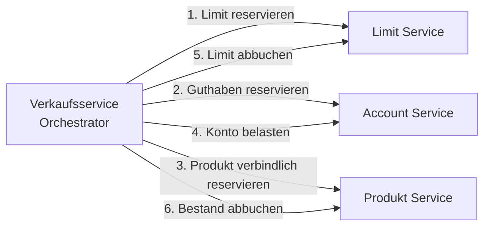
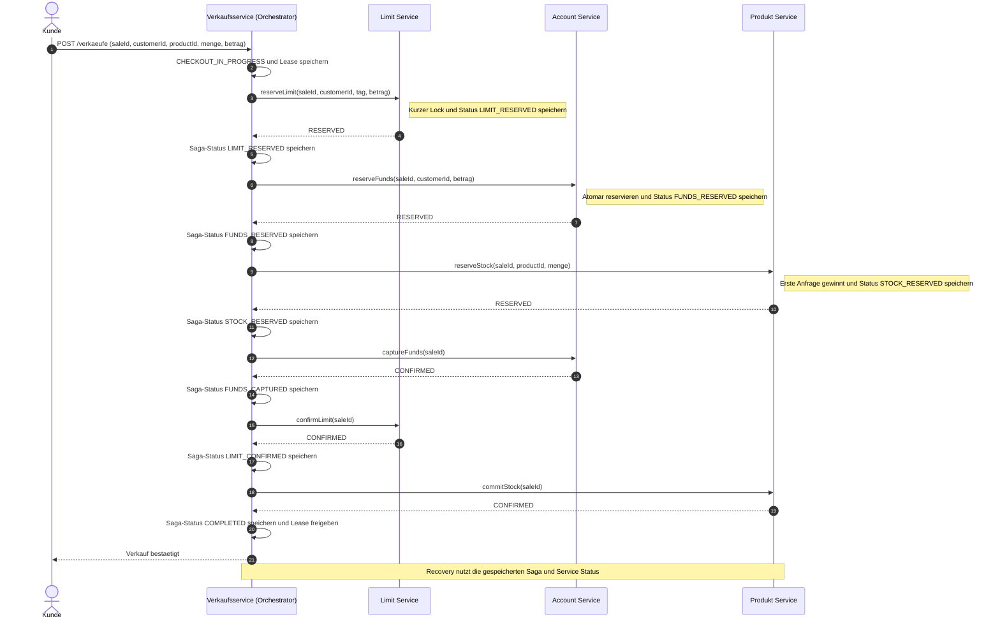

# Orchestrierung: Verkaufsvorgang

Der **Verkaufsservice** ist der Orchestrator der Saga. Er steuert die Reihenfolge
der Reservierungen und kennt als einziger Service den vollständigen Zustand eines
Verkaufsvorgangs. `saleId` ist ein vom Client erzeugter Idempotenzschlüssel; jede
Reservierung und jede Kompensation wird mit derselben `saleId` ausgeführt.

## Komponenten und Aufrufe

Der Verkaufsservice ruft die Fachservices erst beim Checkout in dieser Reihenfolge
auf. Scheitert ein Reservierungsschritt, werden die zuvor erfolgreichen
Reservierungen in umgekehrter Reihenfolge freigegeben.

## Ablauf eines erfolgreichen Verkaufs

## Designentscheidungen

- **Saga mit zentraler Orchestrierung:** Der Verkaufsservice entscheidet über den nächsten Schritt und die Kompensation. Das macht den Ablauf, den Recovery-Fall und die Fehlerbehandlung nachvollziehbar, ohne dass die drei Fachservices voneinander abhängig werden.
- **Ein aktiver Checkout pro Account:** Der Verkaufsservice speichert für jeden Account eine dauerhafte Checkout-Lease mit `saleId` und Status `CHECKOUT_IN_PROGRESS`. Damit kann nur ein Tab desselben Accounts gleichzeitig einkaufen; ein weiterer Tab erhält den laufenden Checkout oder eine passende Fehlermeldung. Die Lease ist keine lange Datenbanktransaktion, sondern ein gespeicherter Zustand mit Ablaufzeit. Sie wird nach Erfolg, Fehler oder Recovery freigegeben. Das reduziert unnötige parallele Anfragen desselben Accounts, ohne bei einem Absturz dauerhaft zu blockieren.
- **Tabs pruefen unverbindlich, Checkout reserviert verbindlich:** Eine Verfügbarkeitsanzeige im Warenkorb erzeugt keine Reservierung. Erst beim Checkout werden Limit, Guthaben und Bestand verbindlich reserviert. Deshalb gewinnt die erste erfolgreich verarbeitete Checkout-Anfrage; ein späterer Checkout wird abgelehnt, wenn Limit, Guthaben oder Bestand nicht mehr ausreichen. Ein später geöffneter Tab kann keine erfolgreiche Reservierung eines anderen Tabs ersetzen.
- **Reihenfolge Limit -> Konto -> Produkt:** Das Tageslimit wird zuerst reserviert, weil es rechtlich relevant ist und vor jedem Verkauf sicher eingehalten werden muss. Danach wird das vorhandene Guthaben nur reserviert, aber noch nicht abgebucht. Anschließend reserviert der Produkt Service den Bestand. Erst wenn alle drei Reservierungen erfolgreich sind, werden die endgültigen Buchungen ausgeführt.
- **Produktvergabe und Abbuchung:** `reserveStock` ist die verbindliche Zusage des Produkts an den Kunden. Die erste Anfrage, die der Produkt Service atomar akzeptiert, gewinnt; maßgeblich ist die Reihenfolge am Produkt Service, nicht der lokale Klickzeitpunkt im Browser. Erst nach dieser Produktbestätigung ruft der Verkaufsservice `captureFunds` auf und bucht das Geld tatsächlich ab. Davor ist das Guthaben nur reserviert. So wird niemand belastet, bevor das Produkt für ihn gesichert ist. Schlägt die Abbuchung fehl, werden Produkt- und Limitreservierung wieder freigegeben.
- **Limit Service trotz Checkout-Lease robust halten:** Beim Checkout erhält der Limit Service zusätzlich kurzzeitig einen pessimistischen Lock für genau einen `(customerId, tag)`-Datensatz. Er reserviert nur dann, wenn das verbleibende Tageslimit ausreicht. Das schützt auch gegen parallele Retries, doppelte Requests oder direkte Aufrufe, die die Checkout-Lease umgehen könnten.
- **Unterschiedliche Nebenläufigkeitsstrategie:** Der Account Service reserviert das Guthaben atomar und idempotent; reicht das verfügbare Guthaben nach einer anderen erfolgreichen Reservierung nicht mehr aus, schlägt die spätere Anfrage fehl. Der Produkt Service nutzt optimistische Nebenläufigkeit: Das Update enthält die gelesene `version` und die Bedingung `stock - reserved >= menge`. Bei einem Versionskonflikt wird neu gelesen; reicht der Bestand dann nicht mehr, schlägt dieser Kauf fehl. Alle drei Services folgen damit dem gleichen Geschäftsverhalten: Die erste erfolgreiche Checkout-Reservierung gewinnt. Die technische Umsetzung ist je Service unterschiedlich.
- **Dauerhafte Zustände:** Der Orchestrator speichert jeden Saga-Schritt in der Verkaufs-DB. Jeder Fachservice speichert seinen Reservierungs- bzw. Abschlussstatus zusammen mit der Änderung der fachlichen Daten. Dadurch kann ein Absturz keine bereits ausgeführte Reservierung unsichtbar machen.
- **Kompensation bei fachlichem Fehler:** Liefert der Account Service den nicht wiederholbaren Fehler, markiert der Verkaufsservice die Saga als `COMPENSATING`, ruft `releaseLimit(saleId)` auf und beendet sie als `FAILED`. Falls die Produktreservierung fachlich scheitert, werden `releaseFunds(saleId)` und danach `releaseLimit(saleId)` ausgeführt. Eine nicht abgeschlossene Saga verbraucht somit weder Limit noch Guthaben dauerhaft.
- **Timeout am Produkt Service:** Ein Timeout bedeutet ein unbekanntes Ergebnis, nicht automatisch einen Fehlschlag. Der Verkaufsservice fragt daher zuerst `getReservationStatus(saleId)` ab oder wiederholt `reserveStock` mit derselben `saleId`. Nur ein bestätigtes `NOT_RESERVED` bzw. ein definierter Ablauf der Reservierung löst die Kompensation aus. Bei einem bestätigten `RESERVED` wird die Saga normal fortgesetzt.
- **Finalisierung und Recovery:** `confirmLimit`, `captureFunds` und `commitStock` sind ebenfalls idempotent. Scheitert der Orchestrator während der Finalisierung, rekonstruiert er die Saga aus der Verkaufs-DB und den Service-Statusdaten und wiederholt nur die noch offenen Aufrufe. Reservierungen erhalten zusätzlich eine Ablaufzeit; ein Recovery-Job klärt abgelaufene, nicht terminale Sagas anhand der gespeicherten `saleId`.
