# Orchestrierung: Verkaufsvorgang

Der **Verkaufsservice** ist der Orchestrator der Saga. Er steuert die Reihenfolge
der Reservierungen und kennt als einziger Service den vollständigen Zustand eines
Verkaufsvorgangs. `saleId` ist ein vom Client erzeugter Idempotenzschlüssel; jede
Reservierung und jede Kompensation wird mit derselben `saleId` ausgeführt.

## Happy Path: Komponentendiagramm

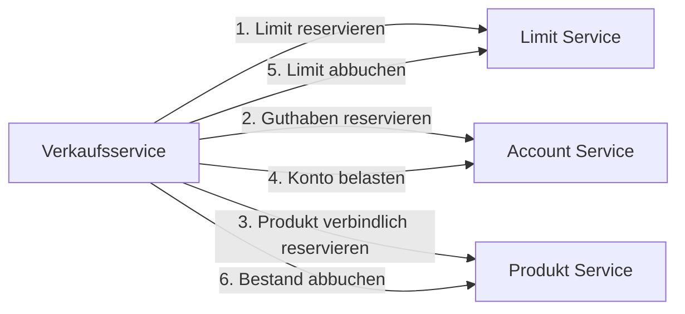

Der Verkaufsservice ruft die Fachservices erst beim Checkout in dieser Reihenfolge
auf. Scheitert ein Reservierungsschritt, werden die zuvor erfolgreichen
Reservierungen in umgekehrter Reihenfolge freigegeben.

## Ablauf eines erfolgreichen Verkaufs

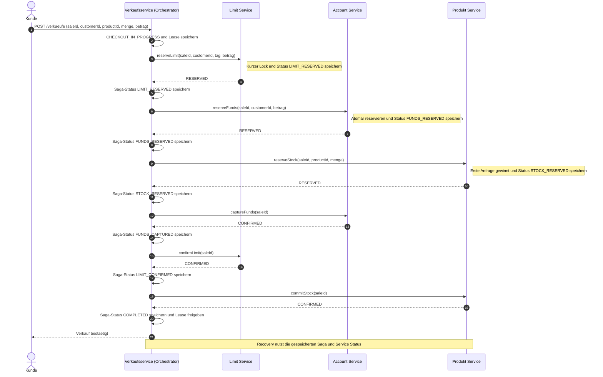

### Entscheidungen im Happy Path

- **Ein Checkout pro Account:** Der Verkaufsservice hält eine gespeicherte
  Checkout-Lease mit `saleId`. Ein zweiter Tab kann deshalb keinen parallelen
  Kauf starten; die Lease wird nach Abschluss, Fehler oder Ablauf freigegeben.
- **Verbindliche Reservierungen erst beim Checkout:** Eine Warenkorbprüfung ist
  unverbindlich. Beim Checkout reserviert der Limit Service zuerst unter einem
  kurzen Lock; danach reservieren Account und Produkt atomar. Damit gewinnt die
  erste erfolgreich verarbeitete Anfrage, ohne das Limit, Guthaben oder den
  Bestand zu überschreiten.
- **Produkt vor Abbuchung:** `reserveStock` sichert das Produkt für den Kunden.
  Erst danach wird Guthaben belastet; Limit und Bestand werden anschließend
  endgültig gebucht. Jeder Schritt und seine Antwort werden als Saga-Status
  gespeichert, damit ein Neustart den Ablauf fortsetzen kann.

## Fehlerpfad 1a: Account Service scheitert bei der Guthabenreservierung

Der Account Service liefert nach 10 ms einen nicht wiederholbaren Fehler bei
`reserveFunds`. Der ursprüngliche Aufruf wird nicht wiederholt, weil unklar ist,
ob der Service die Reservierung kurz vor dem Fehler bereits gespeichert hat.

### Komponentendiagramm

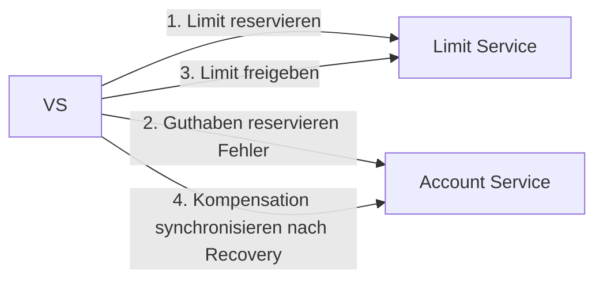

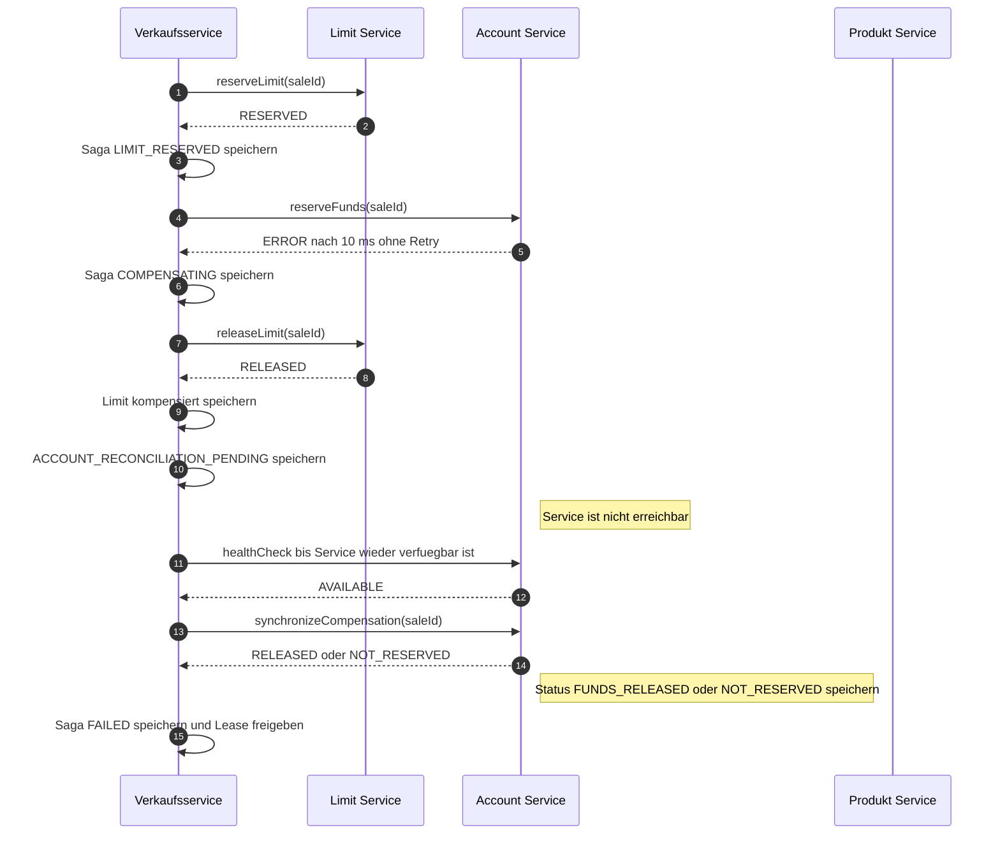

### Entscheidungen in Fehlerpfad 1a

- Die Limitreservierung wird sofort freigegeben, weil ihr Erfolg sicher bekannt
  ist.
- `reserveFunds` wird nicht wiederholt. Stattdessen wird
  `ACCOUNT_RECONCILIATION_PENDING` gespeichert, damit die Kompensation nicht bei
  einem Absturz verloren geht.
- Erst wenn Account Service wieder verfügbar ist, synchronisiert
  `synchronizeCompensation(saleId)` die möglicherweise entstandene Reservierung
  zu `FUNDS_RELEASED` oder `NOT_RESERVED`.

## Fehlerpfad 1b: Account Service scheitert beim Abbuchen

Hier waren Limit, Guthaben und Produkt bereits reserviert. Der Fehler bei
`captureFunds` bedeutet deshalb, dass alle drei Reservierungen kompensiert werden
müssen.

### Komponentendiagramm

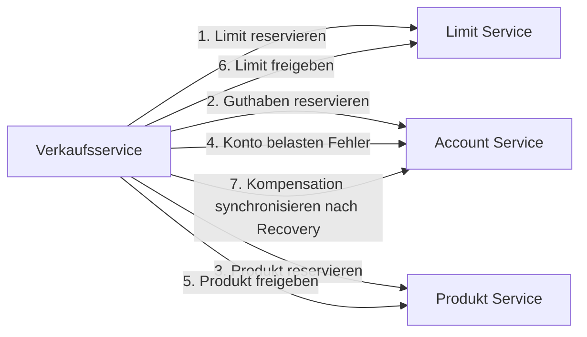

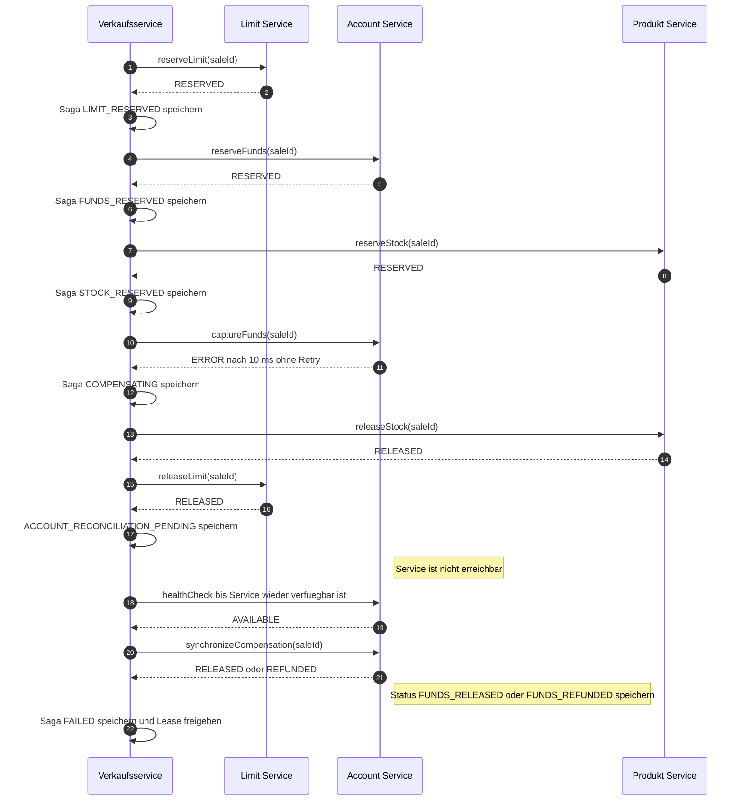

### Entscheidungen in Fehlerpfad 1b

- Produkt und Limit werden sofort freigegeben, weil beide Services erreichbar
  sind und ihre Reservierungen sicher bekannt sind.
- Für Account wird `ACCOUNT_RECONCILIATION_PENDING` gespeichert. So lange der
  Service down ist, bleibt die Kompensation bestehen und der ursprüngliche
  Abbuchungsaufruf wird nicht wiederholt.
- Nach Recovery führt `synchronizeCompensation(saleId)` zu `FUNDS_RELEASED`.
  Falls die Belastung vor dem Fehler schon erfolgt war, wird stattdessen
  `FUNDS_REFUNDED` gespeichert. Erst danach wird die Saga endgültig als
  `FAILED` abgeschlossen und die Lease freigegeben.

## Fehlerpfad 2a: Timeout bei der Produktreservierung

Ein Timeout bei `reserveStock` ist kein sicherer Fehler: Der Produkt Service
könnte den Bestand bereits reserviert haben, bevor die Antwort verloren ging.

### 2a.1 Retry der Produktreservierung ist erfolgreich

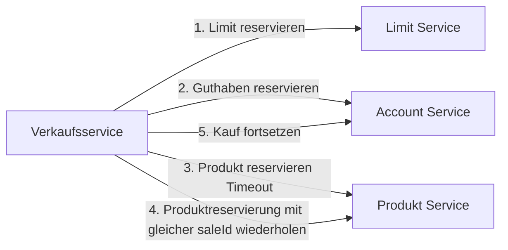

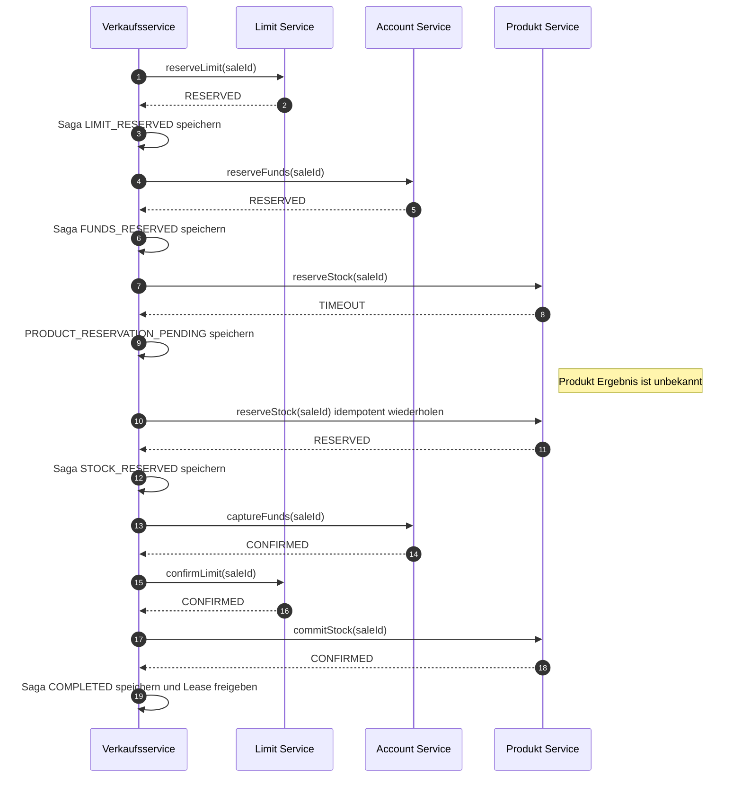

#### Entscheidung in 2a.1

- Der Verkaufsservice speichert `PRODUCT_RESERVATION_PENDING`. Sobald Product
  Service nach dem Timeout wieder antwortet, wird exakt derselbe
  `reserveStock`-Aufruf mit derselben `saleId` wiederholt. Der Produkt Service
  liefert dann entweder die schon vorhandene Reservierung oder legt genau eine
  neue an.
- Weil der Retry `RESERVED` zurückgibt, wird der Kauf normal fortgesetzt. Die
  idempotente `saleId` stellt sicher, dass der Bestand höchstens einmal
  reserviert wird.

### 2a.2 Retry der Produktreservierung scheitert erneut

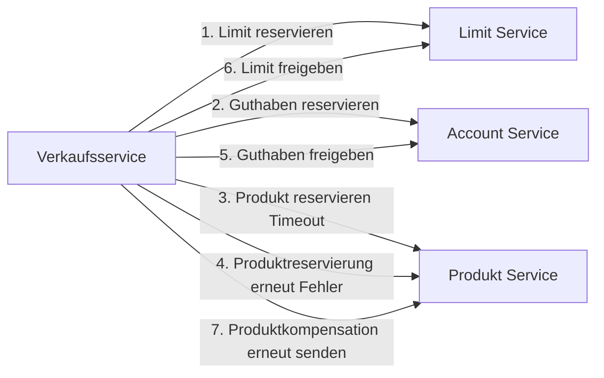

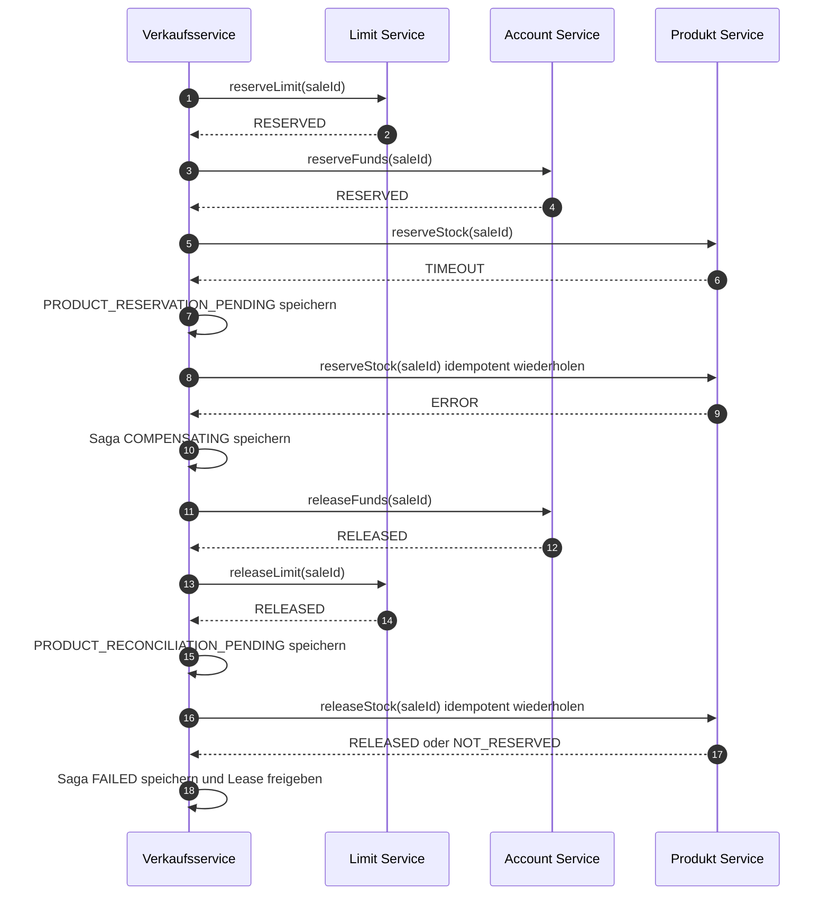

#### Entscheidung in 2a.2

- Guthaben und Limit werden sofort freigegeben, weil deren Reservierungen
  sicher bekannt sind.
- `PRODUCT_RECONCILIATION_PENDING` bleibt gespeichert, bis der Produkt Service
  die idempotente Freigabe bestätigt. `releaseStock(saleId)` löst dann eine
  möglicherweise durch einen der beiden Aufrufe entstandene Produktreservierung
  auf.
- Das entspricht dem Kompensationsmuster aus Fehlerpfad 1: Der fehlgeschlagene
  Kauf wird nicht fortgesetzt, aber jede unbekannte Teilwirkung wird später
  idempotent bereinigt.

## Fehlerpfad 2b: Timeout beim endgültigen Abbuchen des Bestands

Hier sind Limit und Guthaben bereits endgültig gebucht. Der Timeout bei
`commitStock` lässt offen, ob der Bestand schon abgebucht wurde.

### 2b.1 Retry des Bestandsabbuchens ist erfolgreich

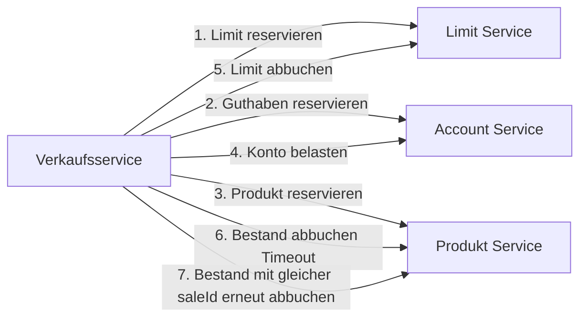

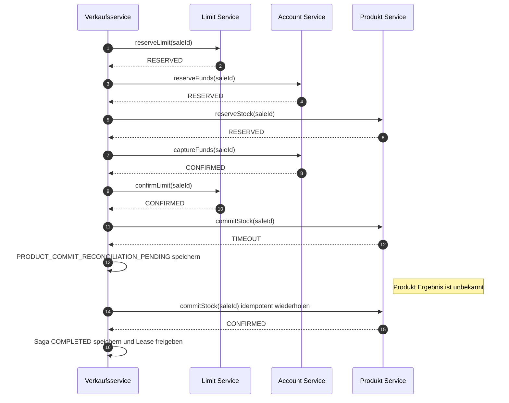

#### Entscheidung in 2b.1

- Geld und Limit werden nicht sofort kompensiert, weil der erste
  `commitStock`-Aufruf trotz Timeout bereits erfolgreich gewesen sein kann.
- Derselbe idempotente `commitStock(saleId)`-Aufruf liefert beim Retry
  `CONFIRMED`, unabhängig davon, ob der erste oder der zweite Aufruf die
  Bestandsbuchung tatsächlich durchgeführt hat.

### 2b.2 Retry des Bestandsabbuchens scheitert erneut

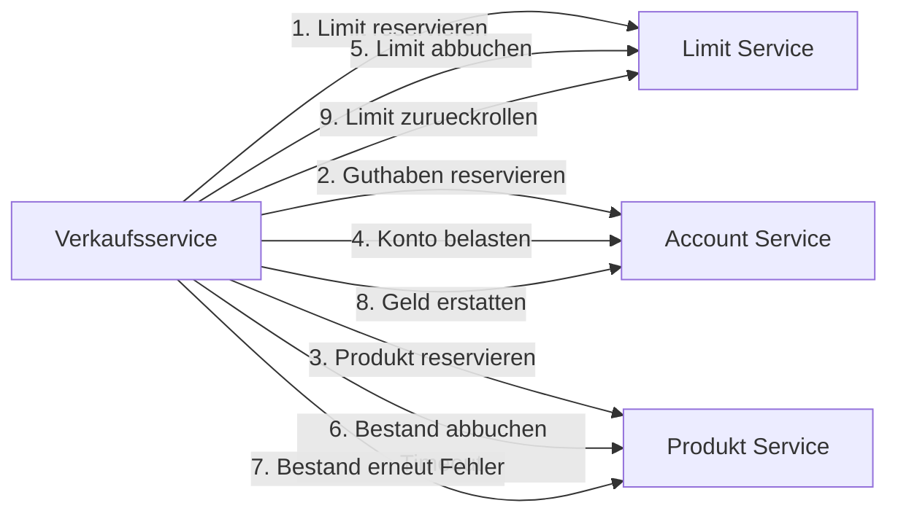

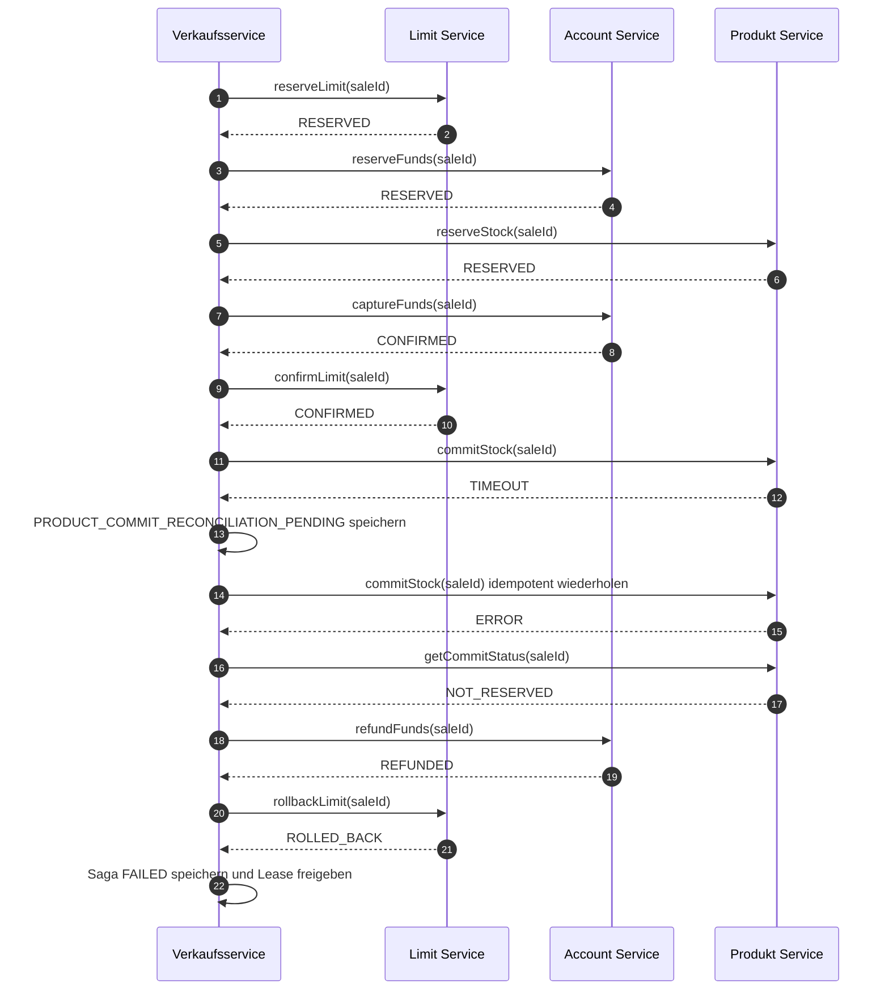

#### Entscheidung in 2b.2

- Nach einem zweiten Fehler wird anhand der idempotenten `saleId` der
  Produktstatus abgefragt. Dieses Diagramm zeigt den Fall `NOT_RESERVED`.
- Weil kein Produkt verbindlich gebucht wurde, wird die bereits erfolgte
  Zahlung erstattet und das Tageslimit zurückgerollt.
- Ergibt die Statusabfrage stattdessen `CONFIRMED`, gilt dieselbe erfolgreiche
  Auflösung wie in 2b.1; es wird weder erstattet noch zurückgerollt.

# Choreographie

Bei der Choreographie startet der Kunde den Kauf beim Limit Service. Die
Fachservices entscheiden anhand von Ereignissen selbst, welchen Schritt oder
welche Kompensation sie ausführen. Die Pfeile mit
`... event` stehen für dauerhaft publizierte Ereignisse; ein konkretes
Messaging-System wird hier bewusst nicht festgelegt.

## Happy Path: Komponentendiagramm

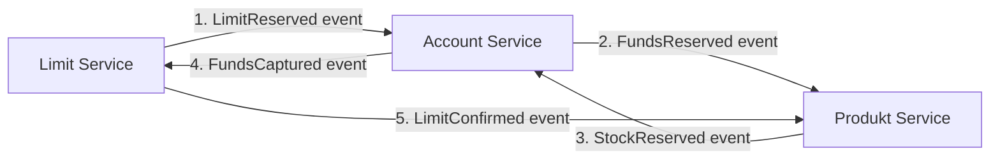

## Ablauf eines erfolgreichen Verkaufs

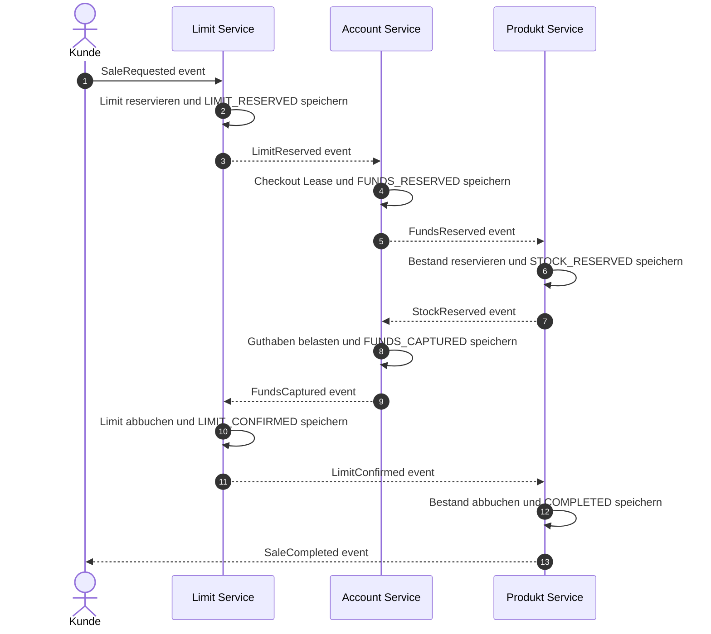

### Entscheidungen im Happy Path

- Es gibt keinen Verkaufsservice. Jeder Fachservice reagiert nur auf ein
  Ereignis und publiziert nach seiner eigenen dauerhaften Änderung das nächste
  Ereignis.
- `saleId` ist bei jedem Ereignis enthalten. Dadurch sind doppelte Zustellungen
  idempotent und führen nicht zu einer zweiten Reservierung oder Buchung.
- Account Service speichert beim Empfang von `LimitReserved` die Checkout Lease
  pro Account. Damit können mehrere Tabs keinen parallelen Kauf auslösen.
- Die Reihenfolge bleibt fachlich gleich: Limit und Guthaben werden reserviert,
  das Produkt wird verbindlich zugeteilt und erst danach wird Geld belastet.

## Fehlerpfad 1a: Account Service scheitert bei der Guthabenreservierung

### Komponentendiagramm

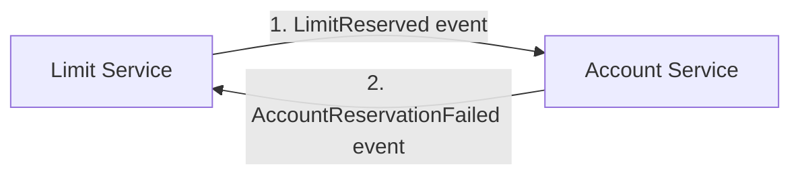

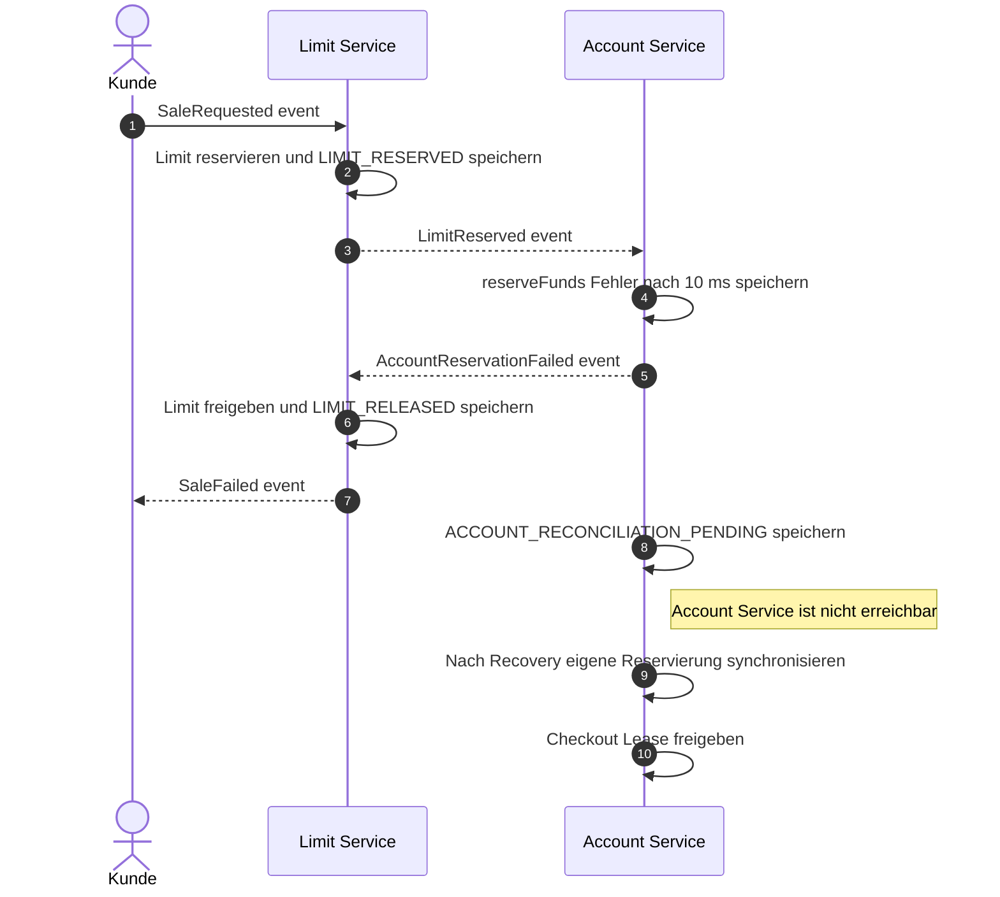

### Entscheidungen in Fehlerpfad 1a

- Account Service publiziert das Fehlerereignis; Limit Service reagiert selbst
  darauf und gibt seine Reservierung frei. Es gibt keinen zentralen
  Kompensationsaufruf.
- Account Service hält seine Kompensationsaufgabe dauerhaft. Nach Recovery löst
  er eine eventuell entstandene Reservierung mit derselben `saleId` auf und
  publiziert erst dann `AccountReconciled`.

## Fehlerpfad 1b: Account Service scheitert beim Abbuchen

### Komponentendiagramm

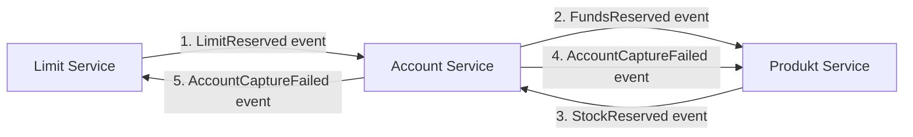

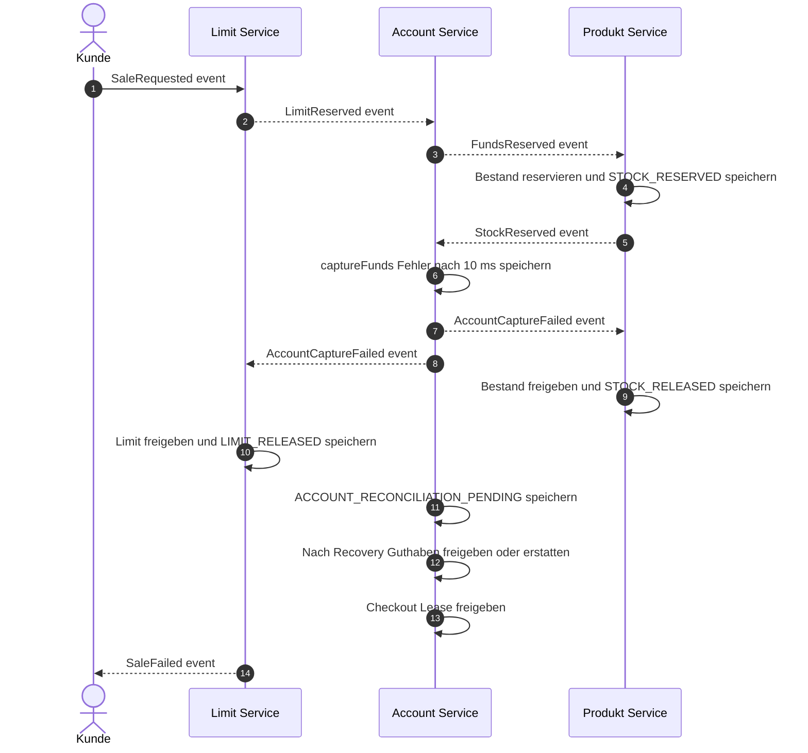

### Entscheidungen in Fehlerpfad 1b

- Das Fehlerereignis wird an alle betroffenen Services publiziert. Produkt und
  Limit kompensieren sich unabhängig und parallel.
- Account Service klärt seine unbekannte Teilwirkung nach Recovery selbst. Je
  nach Zustand wird Guthaben freigegeben oder eine bereits erfolgte Belastung
  erstattet.

## Fehlerpfad 2a: Timeout bei der Produktreservierung

### 2a.1 Retry der Produktreservierung ist erfolgreich

```mermaid
flowchart LR
    LS[Limit Service]
    AS[Account Service]
    PS[Produkt Service]

    LS -->|1. LimitReserved event| AS
    AS -->|2. FundsReserved event| PS
    PS -->|3. Verarbeitung Timeout| PS
    PS -->|4. Gleiche Nachricht erneut verarbeiten| PS
    PS -->|5. StockReserved event| AS
```

```mermaid
sequenceDiagram
    autonumber
    participant LS as Limit Service
    participant AS as Account Service
    participant PS as Produkt Service

    LS-->>AS: LimitReserved event
    AS->>AS: Guthaben reservieren
    AS-->>PS: FundsReserved event
    PS->>PS: reserveStock Verarbeitung Timeout
    PS->>PS: FundsReserved mit gleicher saleId erneut verarbeiten
    PS->>PS: Bestand einmalig reservieren und STOCK_RESERVED speichern
    PS-->>AS: StockReserved event
    AS-->>LS: FundsCaptured event
    LS-->>PS: LimitConfirmed event
```

#### Entscheidung in 2a.1

- Die erneute Zustellung desselben `FundsReserved`-Ereignisses ist erlaubt,
  weil Product Service anhand der `saleId` genau einmal reserviert.
- Sobald `StockReserved` publiziert wird, läuft die Choreographie normal weiter.

### 2a.2 Retry der Produktreservierung scheitert erneut

```mermaid
flowchart LR
    LS[Limit Service]
    AS[Account Service]
    PS[Produkt Service]

    AS -->|1. FundsReserved event| PS
    PS -->|2. ProductReservationFailed event| AS
    PS -->|3. ProductReservationFailed event| LS
    AS -->|4. FundsReleased event| PS
    LS -->|5. LimitReleased event| PS
```

```mermaid
sequenceDiagram
    autonumber
    participant LS as Limit Service
    participant AS as Account Service
    participant PS as Produkt Service

    AS-->>PS: FundsReserved event
    PS->>PS: Zweiter Verarbeitungsversuch schlaegt fehl
    PS-->>AS: ProductReservationFailed event
    PS-->>LS: ProductReservationFailed event
    AS->>AS: Guthaben freigeben und FUNDS_RELEASED speichern
    LS->>LS: Limit freigeben und LIMIT_RELEASED speichern
    AS-->>PS: FundsReleased event
    LS-->>PS: LimitReleased event
    PS->>PS: Eigene unklare Reservierung nach Recovery freigeben
```

#### Entscheidung in 2a.2

- Product Service löst das Fehlerereignis aus. Account und Limit reagieren
  unabhängig und geben ihre sicher bekannten Reservierungen frei.
- Product Service verarbeitet die eingehenden Freigabeereignisse idempotent und
  bereinigt so eine möglicherweise durch den ersten Versuch entstandene
  Bestandsreservierung.

## Fehlerpfad 2b: Timeout beim endgültigen Abbuchen des Bestands

### 2b.1 Retry des Bestandsabbuchens ist erfolgreich

```mermaid
flowchart LR
    AS[Account Service]
    LS[Limit Service]
    PS[Produkt Service]

    AS -->|1. FundsCaptured event| LS
    LS -->|2. LimitConfirmed event| PS
    PS -->|3. Verarbeitung Timeout| PS
    PS -->|4. Gleiche Nachricht erneut verarbeiten| PS
```

```mermaid
sequenceDiagram
    autonumber
    participant AS as Account Service
    participant LS as Limit Service
    participant PS as Produkt Service

    AS-->>LS: FundsCaptured event
    LS->>LS: Limit abbuchen und LIMIT_CONFIRMED speichern
    LS-->>PS: LimitConfirmed event
    PS->>PS: commitStock Verarbeitung Timeout
    PS->>PS: LimitConfirmed mit gleicher saleId erneut verarbeiten
    PS->>PS: Bestand einmalig abbuchen und COMPLETED speichern
```

#### Entscheidung in 2b.1

- Die erneute Zustellung von `LimitConfirmed` ist sicher, weil `commitStock`
  mit der `saleId` idempotent ist.
- Ein bereits verarbeitetes Ereignis liefert nur erneut `SaleCompleted`; der
  Bestand wird nicht zweimal abgebucht.

### 2b.2 Retry des Bestandsabbuchens scheitert erneut

```mermaid
flowchart LR
    AS[Account Service]
    LS[Limit Service]
    PS[Produkt Service]

    LS -->|1. LimitConfirmed event| PS
    PS -->|2. ProductCommitFailed event| AS
    PS -->|3. ProductCommitFailed event| LS
    AS -->|4. FundsRefunded event| PS
    LS -->|5. LimitRolledBack event| PS
```

```mermaid
sequenceDiagram
    autonumber
    participant AS as Account Service
    participant LS as Limit Service
    participant PS as Produkt Service

    LS-->>PS: LimitConfirmed event
    PS->>PS: Zweiter commitStock Versuch schlaegt fehl
    PS-->>AS: ProductCommitFailed event
    PS-->>LS: ProductCommitFailed event
    AS->>AS: Guthaben erstatten und FUNDS_REFUNDED speichern
    LS->>LS: Limit zurueckrollen und LIMIT_ROLLED_BACK speichern
    AS-->>PS: FundsRefunded event
    LS-->>PS: LimitRolledBack event
    PS->>PS: Unklare Bestandsbuchung nach Recovery bereinigen
```

#### Entscheidung in 2b.2

- Erst nach dem zweiten fehlgeschlagenen Verarbeitungsversuch publiziert Product
  Service `ProductCommitFailed`. Dadurch wird nicht versehentlich erstattet,
  obwohl die erste Bestandsbuchung bereits erfolgreich war.
- Account und Limit kompensieren ihre endgültigen Buchungen als Reaktion auf das
  Fehlerereignis. Product Service bereinigt seine unklare Teilwirkung
  idempotent, sobald sein eigener Zustand wieder verfügbar ist.
