# Orchestrierung: Verkaufsvorgang

Der **Verkaufsservice** ist der Orchestrator der Saga. Er steuert die Reihenfolge
der Reservierungen und kennt als einziger Service den vollständigen Zustand eines
Verkaufsvorgangs. `saleId` ist ein vom Client erzeugter Idempotenzschlüssel; jede
Reservierung und jede Kompensation wird mit derselben `saleId` ausgeführt.

## Gemeinsame Persistenz- und Ereignisregel

Jeder Service besitzt eine **eigene relationale Datenbank** (z. B. PostgreSQL).
In den Sequenzdiagrammen ist jeder Schritt, der Status dauerhaft schreibt, mit
**„speichern (DB)“** markiert. Ein Fachservice antwortet erst, **nachdem** seine
lokale Transaktion committet ist („persist, then respond“). Eine Antwort wie
`RESERVED`, `CONFIRMED`, `RELEASED` oder `REJECTED` bedeutet damit immer, dass
dieser Status bereits in der Datenbank des Services liegt.

| Service | Tabellen | Persistierter Status |
| --- | --- | --- |
| Verkaufsservice | `sale_saga` | `saleId`, Kunde, Produkt, Menge, Betrag, aktueller Saga-Status, Startzeit, Checkout-Lease |
| Limit Service | `daily_limit`, `limit_reservation` | je Kunde und Tag `used` und `reserved`; je `saleId` Betrag, Status und `expires_at` |
| Account Service | `account`, `funds_reservation` | Kontostand `balance` und `reserved`; je `saleId` Betrag, Status und `expires_at` |
| Produkt Service | `stock`, `stock_reservation` | je Produkt `available` und `reserved`; je `saleId` Menge, Status und `expires_at` |

**Orchestrierung:** Der Verkaufsservice speichert nach jeder Antwort den neuen
Saga-Status in `sale_saga`. Der gespeicherte Status bestimmt eindeutig den
nächsten Schritt; nach einem Absturz wird dieser Schritt mit derselben `saleId`
erneut ausgeführt oder kompensiert (siehe [Recovery](#recovery-nach-einem-absturz)).

**Choreographie:** Events werden über das Kafka-Topic `sale-events`
ausgetauscht (Partitionsschlüssel `saleId`, damit alle Events eines Verkaufs
geordnet bleiben). Jeder Service nutzt das **Transactional-Outbox-Muster**:
Statusänderung und ausgehendes Event werden in **derselben lokalen
Transaktion** in die Fachtabelle und in die Tabelle `outbox` geschrieben; ein
Relay publiziert die Outbox-Einträge in das Topic. Ein `... event`-Pfeil in den
Diagrammen steht also immer für „Outbox (DB) → Kafka-Topic `sale-events`“.
Empfänger speichern ihre Statusänderung zusammen mit der verarbeiteten
`messageId` (Tabelle `processed_message`) und committen den Kafka-Offset erst
danach.

## Architektureinordnung

Der Ablauf ist **keine verteilte ACID-Transaktion und kein 2PC**, sondern eine
Saga: Jeder Service führt seine Änderung als lokale, atomare Transaktion aus.
Über Servicegrenzen hinweg wird eine vorübergehende Inkonsistenz akzeptiert und
im Fehlerfall mit einer expliziten Kompensation aufgelöst. Es gibt kein
gemeinsames Datenbankschema.

| Bounded Context / Service | Eigene Datenhoheit | Schreiboperationen |
| --- | --- | --- |
| Verkaufsservice (nur Orchestrierung) | Saga-Status und Checkout-Lease | `startSale`, `cancelSale` |
| Limit Service | Tageslimit und Limitreservierungen | `reserveLimit`, `confirmLimit`, `releaseLimit` (Kompensation vor dem Point of no Return), `rollbackLimit` (nur manueller Storno) |
| Account Service | Guthaben, Geldreservierungen und Account-Lease | `reserveFunds`, `captureFunds`, `releaseFunds` (Kompensation vor dem Point of no Return), `refundFunds` (nur manueller Storno) |
| Produkt Service | Bestand und Bestandsreservierungen | `reserveStock`, `commitStock`, `releaseStock` |

Die Schreiboperationen sind Commands. Statusabfragen wie
`getFundsStatus(saleId)`, `getCommitStatus(saleId)` und `getSaleStatus(saleId)` sind Queries und verändern keinen Zustand. Jeder
Command enthält `saleId`; damit sind Wiederholungen idempotent. Im synchronen
Orchestrierungsfall haben alle Aufrufe ein Timeout und erfolgen nur bei
temporären, als wiederholbar klassifizierten Fehlern erneut. Ein nicht
wiederholbarer Fehler löst dagegen die Kompensation aus.

## Happy Path: Komponentendiagramm

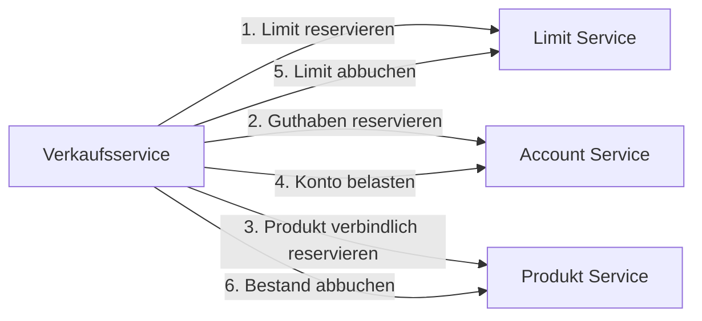

Der Verkaufsservice ruft die Fachservices erst beim Checkout in dieser Reihenfolge
auf. Scheitert ein Reservierungsschritt, werden die zuvor erfolgreichen
Reservierungen in umgekehrter Reihenfolge freigegeben.

## Ablauf eines erfolgreichen Verkaufs

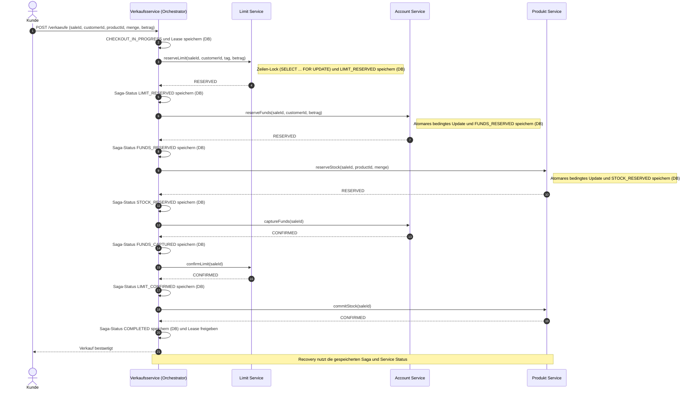

### Entscheidungen im Happy Path

- **Ein Checkout pro Account (Komfort, keine Sicherheitsmaßnahme):** Der
  Verkaufsservice hält eine gespeicherte Checkout-Lease mit `saleId`, damit ein
  zweiter Tab oder ein Doppelklick keinen zweiten Kauf startet. Die Einhaltung
  des Limits hängt **nicht** von dieser Lease ab (siehe
  [Nebenläufigkeit](#nebenläufigkeit)).

- **Verbindliche Reservierungen und Nebenläufigkeit:** Eine Warenkorbprüfung ist
  unverbindlich. Gegen Race Conditions bei parallelen Anfragen greifen gezielte Mechanismen
  (Details und Beispiel im Kapitel [Nebenläufigkeit](#nebenläufigkeit)):
  - *Limit Service (Pessimistisches Locking):* Verwendet ein kurzes Zeilen-Lock
    (`SELECT ... FOR UPDATE`), um parallele Abfragen desselben Kunden strikt zu serialisieren.
  - *Account & Produkt Service (Atomare Reservierung):* Statt getrenntem Lesen und Prüfen
    im Code erfolgt die Reservierung direkt als bedingtes atomares SQL-Update
    (`WHERE balance - reserved >= betrag` bzw. `WHERE available - reserved >= menge`).
    Prüfung und Buchung bilden so einen unteilbaren
    Schritt – die erste Anfrage gewinnt, Überziehungen oder Überverkäufe sind ausgeschlossen.

- **Produkt vor Abbuchung:** `reserveStock` sichert das Produkt für den Kunden.
  Erst danach wird Guthaben belastet; Limit und Bestand werden anschließend
  endgültig gebucht. Jeder Schritt und seine Antwort werden als Saga-Status
  gespeichert, damit ein Neustart den Ablauf fortsetzen oder kompensieren kann
  (siehe [Recovery](#recovery-nach-einem-absturz)).

- **2-Phasen-Muster**
    Um die Kernanforderung zu erfüllen, dass nicht abgeschlossene Verkäufe niemals dauerhaft Limit oder Guthaben verbrauchen, ist der Ablauf strikt in zwei Phasen unterteilt:
  1. *Reservierungsphase:* Alle Ressourcen werden vorab blockiert, aber noch nicht final gebucht. Ein Scheitern in dieser Phase erfordert lediglich ein einfaches Freigeben der Reservierungen ohne buchhalterische Stornos.
  2. *Bestätigungsphase:* Erst wenn alle drei Vorbedingungen erfüllt sind, werden Guthaben belastet, Limit fixiert und der Lagerabgang gebucht.

- **Reihenfolge der Schritte:**
  1. *Limit Service:* Das 200-€-Tageslimit ist eine harte **rechtliche** Vorgabe zur Unterbindung von Großhandel. Es ist die schnellste und ressourcenschonendste Prüfung und weist unberechtigte Anfragen sofort ab, bevor nachgelagerte Services belastet werden.
  2. *Account Service:* Prüft die Zahlungsfähigkeit des Kunden (-> weil Konto nicht überziehbar). Ohne Deckung ist der Kauf ungültig.
  3. *Produkt Service:* "Bei besonders beliebten Produkten versuchen oft mehrere Kunden zeitgleich hohe Stückzahlen einzukaufen" -> Indem Bestände erst als *letzte* Vorbedingung reserviert werden, wird vermieden, dass Kunden ohne ausreichendes Limit oder Guthaben knappe Lagerbestände für andere Kunden blockieren.
  4. *Abbuchungsreihenfolge (Schritte 4–6):* `captureFunds` erfolgt vor `commitStock`, damit gesichert ist, dass das Geld eingezogen wurde, bevor die Ware endgültig das Lager verlässt.

- **Point of no Return:** `captureFunds` ist der Übergang von der
  Reservierungs- in die Bestätigungsphase. Bis dahin wird bei einem Fehler
  zurückgerollt, ab dem gespeicherten Saga-Status `FUNDS_CAPTURED` nur noch
  vorwärts abgeschlossen (siehe nächster Abschnitt).

## Reihenfolge der Schritte und Point of no Return

Die Begründung der Reihenfolge steht in den Entscheidungen oben. Die Tabelle
zeigt, was bei einem Fehler in jedem Schritt passiert:

| Nr. | Schritt | Phase | Bei Fehler |
| --- | --- | --- | --- |
| 1 | `reserveLimit` | Reservierung | nichts zu kompensieren |
| 2 | `reserveFunds` | Reservierung | Limit freigeben |
| 3 | `reserveStock` | Reservierung | Guthaben und Limit freigeben |
| 4 | `captureFunds` | **Point of no Return** | scheitert die Abbuchung selbst eindeutig, wird alles freigegeben (Fehlerpfad 1b) |
| 5 | `confirmLimit` | Bestätigung | **kein Rückrollen**, idempotent wiederholen |
| 6 | `commitStock` | Bestätigung | **kein Rückrollen**, idempotent wiederholen (Fehlerpfad 2b) |

**Bis einschließlich Schritt 4** wird bei einem eindeutigen Fehler
zurückgerollt (Backward Recovery). **Ab dem gespeicherten Saga-Status
`FUNDS_CAPTURED`** wird nicht mehr zurückgerollt, sondern nur noch vorwärts
abgeschlossen (Forward Recovery). Das ist möglich, weil die Schritte 5 und 6
nur noch bestehende Reservierungen in Buchungen umwandeln: Limit und Bestand
sind für diese `saleId` bereits gesichert, deshalb können diese Schritte
nicht mehr fachlich scheitern, sondern nur technisch (Timeout, Ausfall). Ein
technischer Fehler wird durch idempotente Wiederholung gelöst.

Die Choreographie verwendet dieselbe Reihenfolge; dort markiert das Event
`FundsCaptured` den Point of no Return.


## Fehlerpfad 1a: Account Service scheitert bei der Guthabenreservierung

Der Account Service liefert nach 10 ms einen nicht wiederholbaren Fehler bei
`reserveFunds`. Der ursprüngliche Aufruf wird nicht wiederholt, weil unklar ist,
ob der Service die Reservierung kurz vor dem Fehler bereits gespeichert hat.

### Komponentendiagramm

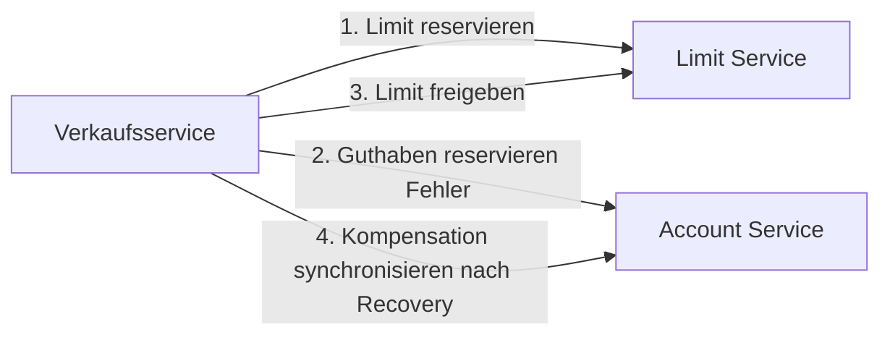

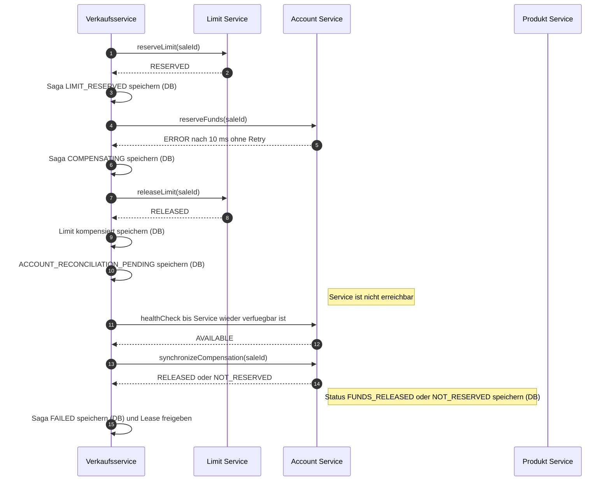

### Entscheidungen in Fehlerpfad 1a

- Die Limitreservierung wird sofort freigegeben, weil ihr Erfolg sicher bekannt
  ist.
- `reserveFunds` wird nicht wiederholt. Stattdessen wird
  `ACCOUNT_RECONCILIATION_PENDING` gespeichert, damit die Kompensation nicht bei
  einem Absturz verloren geht.
- Erst wenn Account Service wieder verfügbar ist, synchronisiert
  `synchronizeCompensation(saleId)` die möglicherweise entstandene Reservierung
  zu `FUNDS_RELEASED` oder `NOT_RESERVED`.

## Fehlerpfad 1b: Account Service scheitert beim Abbuchen

Hier waren Limit, Guthaben und Produkt bereits reserviert. Der Fehler bei
`captureFunds` bedeutet deshalb, dass alle drei Reservierungen kompensiert werden
müssen.

### Komponentendiagramm

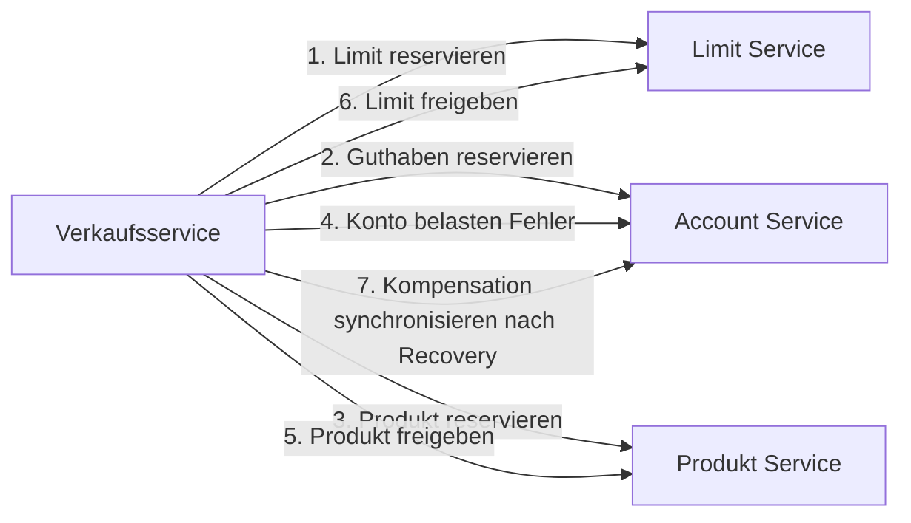

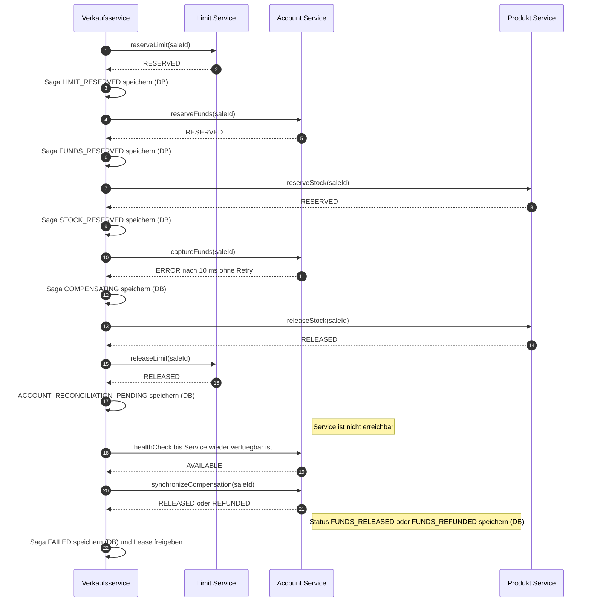

### Entscheidungen in Fehlerpfad 1b

- Produkt und Limit werden sofort freigegeben, weil beide Services erreichbar
  sind und ihre Reservierungen sicher bekannt sind.
- Für Account wird `ACCOUNT_RECONCILIATION_PENDING` gespeichert. So lange der
  Service down ist, bleibt die Kompensation bestehen und der ursprüngliche
  Abbuchungsaufruf wird nicht wiederholt.
- Nach Recovery führt `synchronizeCompensation(saleId)` zu `FUNDS_RELEASED`.
  Falls die Belastung vor dem Fehler schon erfolgt war, wird stattdessen
  `FUNDS_REFUNDED` gespeichert. Erst danach wird die Saga endgültig als
  `FAILED` abgeschlossen und die Lease freigegeben.

## Fehlerpfad 2a: Timeout bei der Produktreservierung

Ein Timeout bei `reserveStock` ist kein sicherer Fehler: Der Produkt Service
könnte den Bestand bereits reserviert haben, bevor die Antwort verloren ging.

### 2a.1 Retry der Produktreservierung ist erfolgreich

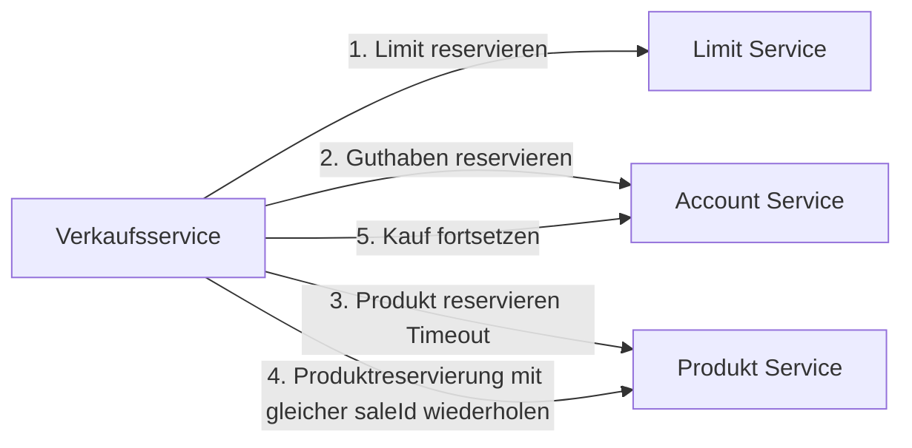

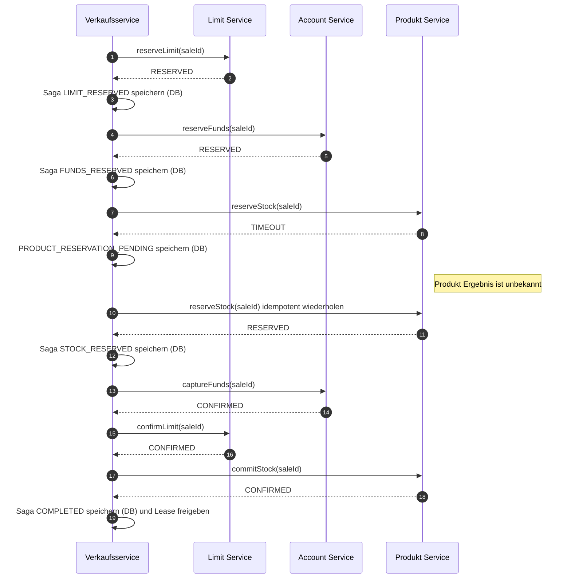

#### Entscheidung in 2a.1

- Der Verkaufsservice speichert `PRODUCT_RESERVATION_PENDING`. Sobald Product
  Service nach dem Timeout wieder antwortet, wird exakt derselbe
  `reserveStock`-Aufruf mit derselben `saleId` wiederholt. Der Produkt Service
  liefert dann entweder die schon vorhandene Reservierung oder legt genau eine
  neue an.
- Weil der Retry `RESERVED` zurückgibt, wird der Kauf normal fortgesetzt. Die
  idempotente `saleId` stellt sicher, dass der Bestand höchstens einmal
  reserviert wird.

### 2a.2 Retry der Produktreservierung scheitert erneut

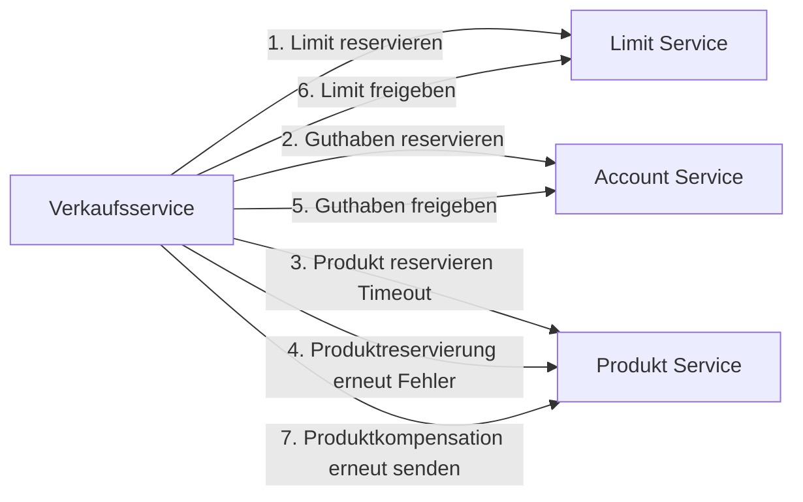

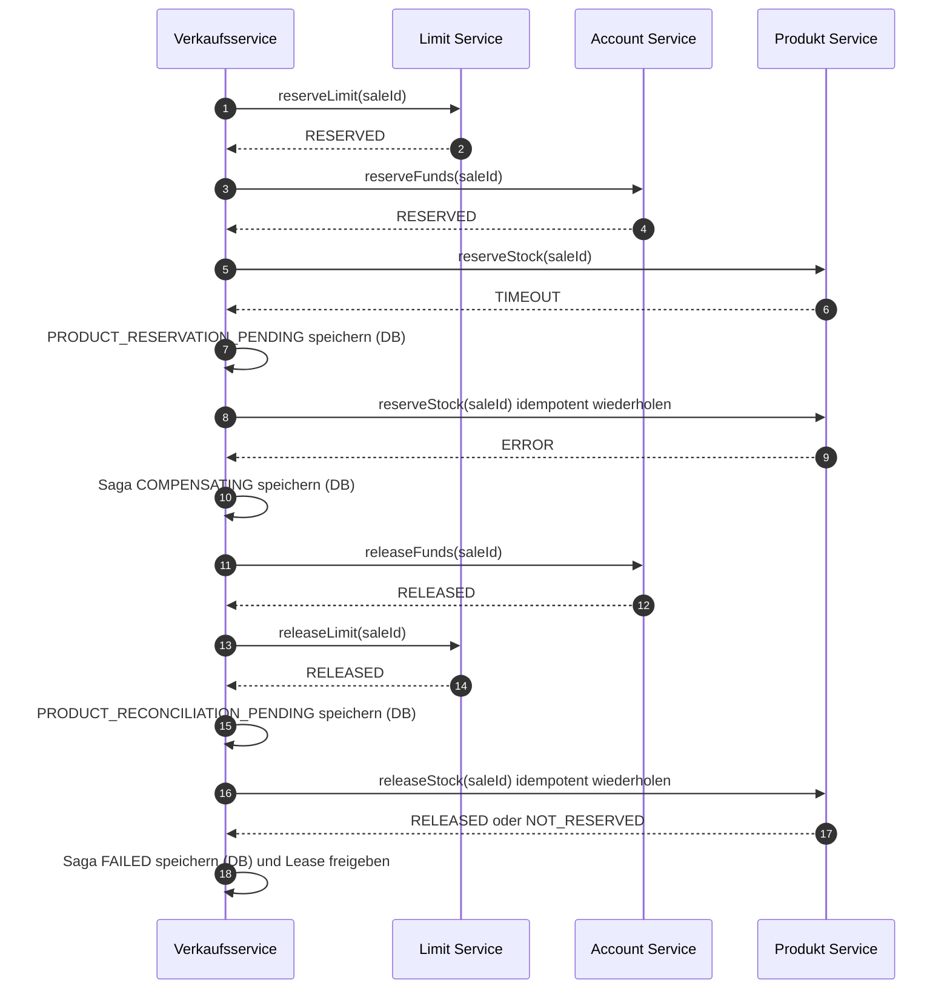

#### Entscheidung in 2a.2

- Guthaben und Limit werden sofort freigegeben, weil deren Reservierungen
  sicher bekannt sind.
- `PRODUCT_RECONCILIATION_PENDING` bleibt gespeichert, bis der Produkt Service
  die idempotente Freigabe bestätigt. `releaseStock(saleId)` löst dann eine
  möglicherweise durch einen der beiden Aufrufe entstandene Produktreservierung
  auf.
- Das entspricht dem Kompensationsmuster aus Fehlerpfad 1: Der fehlgeschlagene
  Kauf wird nicht fortgesetzt, aber jede unbekannte Teilwirkung wird später
  idempotent bereinigt.

## Fehlerpfad 2b: Timeout beim endgültigen Abbuchen des Bestands

Hier sind Limit und Guthaben bereits endgültig gebucht. Der Timeout bei
`commitStock` lässt offen, ob der Bestand schon abgebucht wurde.

### 2b.1 Retry des Bestandsabbuchens ist erfolgreich

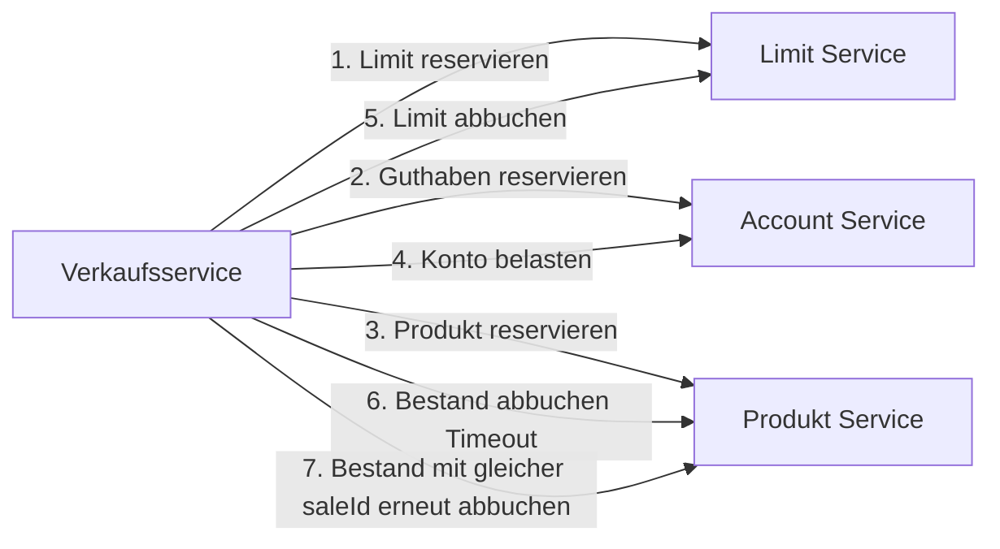

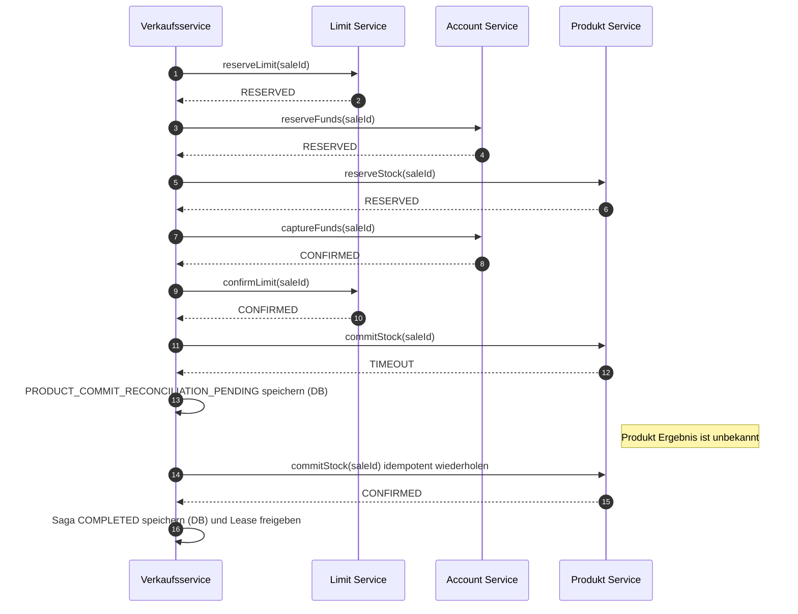

#### Entscheidung in 2b.1

- Geld und Limit werden nicht sofort kompensiert, weil der erste
  `commitStock`-Aufruf trotz Timeout bereits erfolgreich gewesen sein kann.
- Derselbe idempotente `commitStock(saleId)`-Aufruf liefert beim Retry
  `CONFIRMED`, unabhängig davon, ob der erste oder der zweite Aufruf die
  Bestandsbuchung tatsächlich durchgeführt hat.

### 2b.2 Produkt Service bleibt nach dem Timeout länger nicht erreichbar

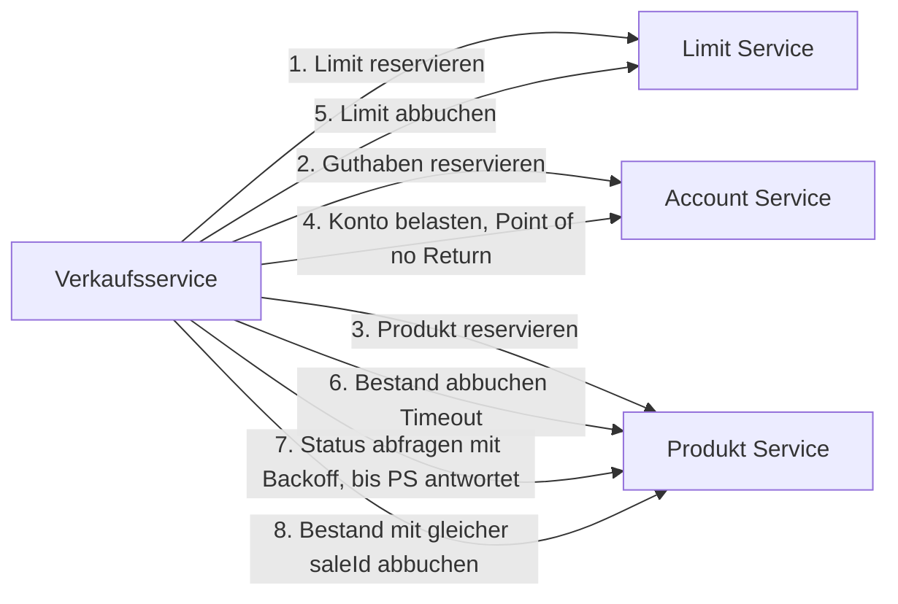

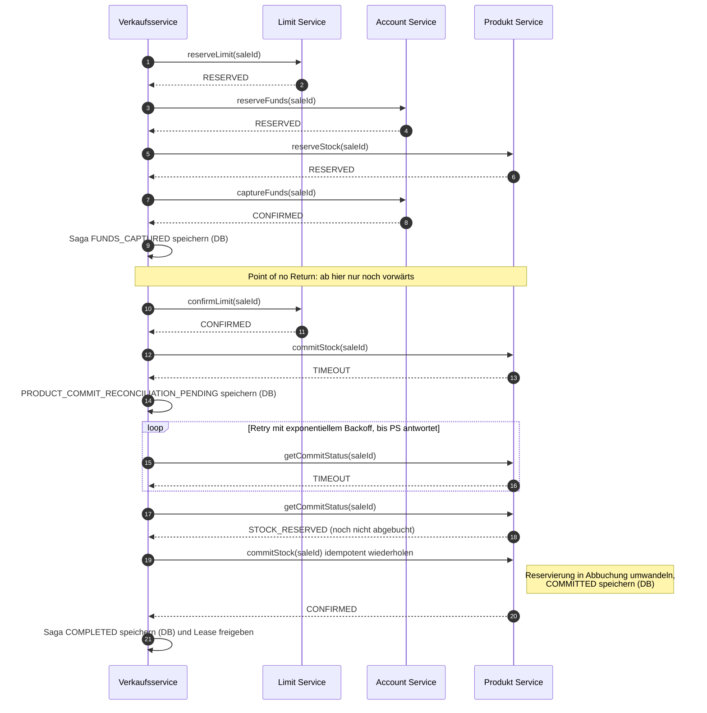

#### Entscheidung in 2b.2

- `commitStock` liegt **nach dem Point of no Return**. Geld und Limit sind
  bereits gebucht, deshalb wird nicht kompensiert, sondern so lange idempotent
  wiederholt, bis der Produkt Service wieder antwortet.
- Das ist sicher, weil der Bestand seit `reserveStock` für diese `saleId`
  reserviert ist. `commitStock` kann daher nur technisch (Timeout, Ausfall),
  aber nicht fachlich scheitern; kein anderer Kunde kann die reservierte Menge
  in der Zwischenzeit kaufen.
- Die Statusabfrage `getCommitStatus(saleId)` klärt das unbekannte Ergebnis des
  ersten Aufrufs: `COMMITTED` → Saga direkt abschließen (wie 2b.1),
  `STOCK_RESERVED` → `commitStock` erneut senden.
- Die Reservierung wird vom Ablaufjob des Produkt Service nicht freigegeben,
  weil der Verkaufsservice auf `getSaleStatus(saleId)` einen Status nach
  `FUNDS_CAPTURED` meldet (siehe
  [Absicherung gegen verwaiste Reservierungen](#absicherung-gegen-verwaiste-reservierungen)).
- Ein fachlicher Sonderfall nach dem Abschluss (z. B. Ware beim Kommissionieren
  beschädigt) ist **kein Teil dieser Saga**, sondern ein eigener, manueller
  Stornoprozess mit `refundFunds` und `rollbackLimit`.

# Choreographie

Bei der Choreographie startet der Kunde den Kauf beim Limit Service. Die
Fachservices entscheiden anhand von Ereignissen selbst, welchen Schritt oder
welche Kompensation sie ausführen. Die Pfeile mit
`... event` stehen für dauerhaft publizierte Ereignisse im Kafka-Topic
`sale-events`, die über die Outbox des sendenden Services geschrieben werden
(siehe [Persistenzregel](#gemeinsame-persistenz--und-ereignisregel)).

## Happy Path: Komponentendiagramm

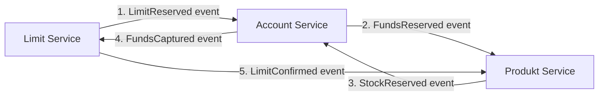

## Ablauf eines erfolgreichen Verkaufs

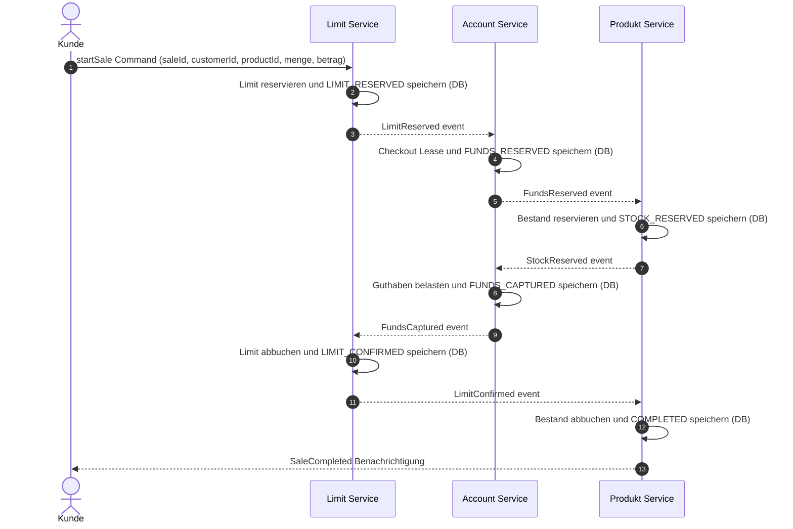

### Entscheidungen im Happy Path

- Es gibt keinen Verkaufsservice. Jeder Fachservice reagiert nur auf ein
  Ereignis und publiziert nach seiner eigenen dauerhaften Änderung das nächste
  Ereignis.
- `saleId` ist bei jedem Ereignis enthalten. Dadurch sind doppelte Zustellungen
  idempotent und führen nicht zu einer zweiten Reservierung oder Buchung.
- Account Service speichert beim Empfang von `LimitReserved` die Checkout Lease
  pro Account, damit mehrere Tabs keinen parallelen Kauf auslösen. Wie bei der
  Orchestrierung ist das nur Komfort: Limit, Guthaben und Bestand werden durch
  die atomaren Reservierungen der Fachservices geschützt (siehe
  [Nebenläufigkeit](#nebenläufigkeit)).
- Die Reihenfolge ist dieselbe wie bei der Orchestrierung und wird dort
  [begründet](#reihenfolge-der-schritte-und-point-of-no-return): Limit und
  Guthaben werden reserviert, das Produkt wird verbindlich zugeteilt und erst
  danach wird Geld belastet. Mit dem Event `FundsCaptured` ist der **Point of
  no Return** erreicht; danach publiziert kein Service mehr ein Ereignis, das
  Kompensationen auslöst.
- Die `... event`-Pfeile sind asynchrone Nachrichten über das Kafka-Topic
  `sale-events`. Jedes Event enthält mindestens `messageId`, `saleId`,
  Ereignistyp, Version und Zeitstempel. Empfänger verarbeiten ein Event nur
  dann, wenn die Zustandsänderung für diese `saleId` noch gültig ist; Duplikate
  und verspätete Events bleiben damit wirkungslos.

## Fehlerpfad 1a: Account Service scheitert bei der Guthabenreservierung

### Komponentendiagramm

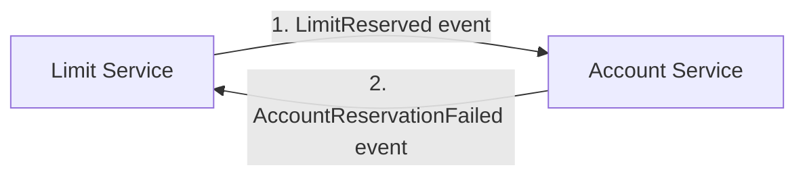

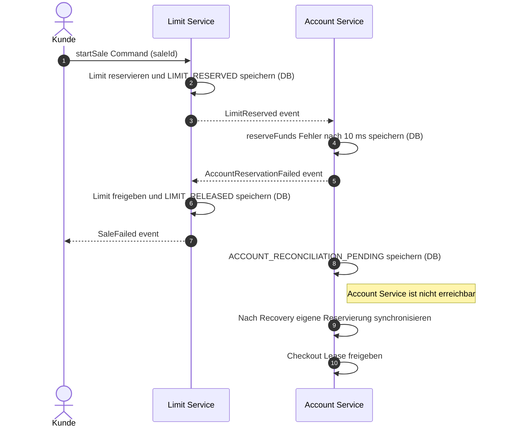

### Entscheidungen in Fehlerpfad 1a

- Account Service publiziert das Fehlerereignis; Limit Service reagiert selbst
  darauf und gibt seine Reservierung frei. Es gibt keinen zentralen
  Kompensationsaufruf.
- Account Service hält seine Kompensationsaufgabe dauerhaft. Nach Recovery löst
  er eine eventuell entstandene Reservierung mit derselben `saleId` auf und
  publiziert erst dann `AccountReconciled`.

## Fehlerpfad 1b: Account Service scheitert beim Abbuchen

### Komponentendiagramm

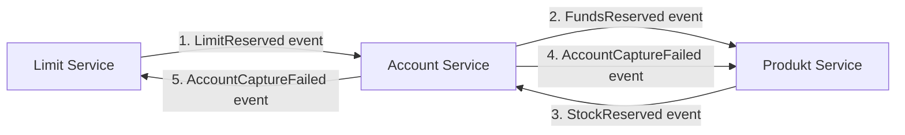

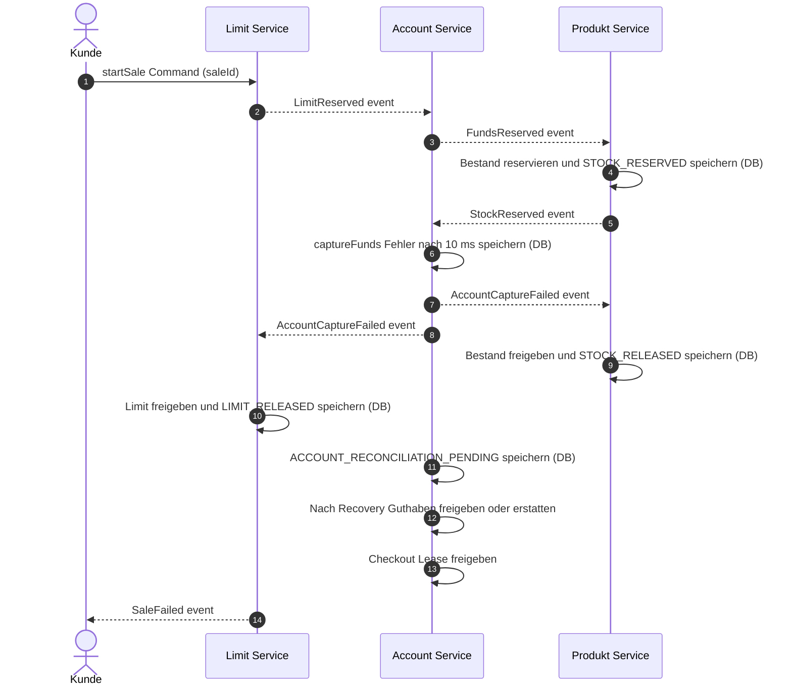

### Entscheidungen in Fehlerpfad 1b

- Das Fehlerereignis wird an alle betroffenen Services publiziert. Produkt und
  Limit kompensieren sich unabhängig und parallel.
- Account Service klärt seine unbekannte Teilwirkung nach Recovery selbst. Je
  nach Zustand wird Guthaben freigegeben oder eine bereits erfolgte Belastung
  erstattet.

## Fehlerpfad 2a: Timeout bei der Produktreservierung

### 2a.1 Retry der Produktreservierung ist erfolgreich

```mermaid
flowchart LR
    LS[Limit Service]
    AS[Account Service]
    PS[Produkt Service]

    LS -->|1. LimitReserved event| AS
    AS -->|2. FundsReserved event| PS
    PS -->|3. Verarbeitung Timeout| PS
    PS -->|4. Gleiche Nachricht erneut verarbeiten| PS
    PS -->|5. StockReserved event| AS
```

```mermaid
sequenceDiagram
    autonumber
    participant LS as Limit Service
    participant AS as Account Service
    participant PS as Produkt Service

    LS-->>AS: LimitReserved event
    AS->>AS: Guthaben reservieren
    AS-->>PS: FundsReserved event
    PS->>PS: reserveStock Verarbeitung Timeout
    PS->>PS: FundsReserved mit gleicher saleId erneut verarbeiten
    PS->>PS: Bestand einmalig reservieren und STOCK_RESERVED speichern (DB)
    PS-->>AS: StockReserved event
    AS-->>LS: FundsCaptured event
    LS-->>PS: LimitConfirmed event
```

#### Entscheidung in 2a.1

- Die erneute Zustellung desselben `FundsReserved`-Ereignisses ist erlaubt,
  weil Product Service anhand der `saleId` genau einmal reserviert.
- Sobald `StockReserved` publiziert wird, läuft die Choreographie normal weiter.

### 2a.2 Retry der Produktreservierung scheitert erneut

```mermaid
flowchart LR
    LS[Limit Service]
    AS[Account Service]
    PS[Produkt Service]

    AS -->|1. FundsReserved event| PS
    PS -->|2. ProductReservationFailed event| AS
    PS -->|3. ProductReservationFailed event| LS
    AS -->|4. FundsReleased event| PS
    LS -->|5. LimitReleased event| PS
```

```mermaid
sequenceDiagram
    autonumber
    participant LS as Limit Service
    participant AS as Account Service
    participant PS as Produkt Service

    AS-->>PS: FundsReserved event
    PS->>PS: Zweiter Verarbeitungsversuch schlaegt fehl
    PS-->>AS: ProductReservationFailed event
    PS-->>LS: ProductReservationFailed event
    AS->>AS: Guthaben freigeben und FUNDS_RELEASED speichern (DB)
    LS->>LS: Limit freigeben und LIMIT_RELEASED speichern (DB)
    AS-->>PS: FundsReleased event
    LS-->>PS: LimitReleased event
    PS->>PS: Eigene unklare Reservierung nach Recovery freigeben
```

#### Entscheidung in 2a.2

- Product Service löst das Fehlerereignis aus. Account und Limit reagieren
  unabhängig und geben ihre sicher bekannten Reservierungen frei.
- Product Service verarbeitet die eingehenden Freigabeereignisse idempotent und
  bereinigt so eine möglicherweise durch den ersten Versuch entstandene
  Bestandsreservierung.

## Fehlerpfad 2b: Timeout beim endgültigen Abbuchen des Bestands

### 2b.1 Retry des Bestandsabbuchens ist erfolgreich

```mermaid
flowchart LR
    AS[Account Service]
    LS[Limit Service]
    PS[Produkt Service]

    AS -->|1. FundsCaptured event| LS
    LS -->|2. LimitConfirmed event| PS
    PS -->|3. Verarbeitung Timeout| PS
    PS -->|4. Gleiche Nachricht erneut verarbeiten| PS
```

```mermaid
sequenceDiagram
    autonumber
    participant AS as Account Service
    participant LS as Limit Service
    participant PS as Produkt Service

    AS-->>LS: FundsCaptured event
    LS->>LS: Limit abbuchen und LIMIT_CONFIRMED speichern (DB)
    LS-->>PS: LimitConfirmed event
    PS->>PS: commitStock Verarbeitung Timeout
    PS->>PS: LimitConfirmed mit gleicher saleId erneut verarbeiten
    PS->>PS: Bestand einmalig abbuchen und COMPLETED speichern (DB)
```

#### Entscheidung in 2b.1

- Die erneute Zustellung von `LimitConfirmed` ist sicher, weil `commitStock`
  mit der `saleId` idempotent ist.
- Ein bereits verarbeitetes Ereignis liefert nur erneut `SaleCompleted`; der
  Bestand wird nicht zweimal abgebucht.

### 2b.2 Produkt Service bleibt nach dem Timeout länger nicht erreichbar

```mermaid
flowchart LR
    AS[Account Service]
    LS[Limit Service]
    PS[Produkt Service]

    AS -->|1. FundsCaptured event, Point of no Return| LS
    LS -->|2. LimitConfirmed event| PS
    PS -->|3. Verarbeitung Timeout, Offset nicht committen| PS
    PS -->|4. Retry mit Backoff, bis die DB antwortet| PS
    PS -->|5. SaleCompleted event| LS
```

```mermaid
sequenceDiagram
    autonumber
    actor Kunde
    participant AS as Account Service
    participant LS as Limit Service
    participant PS as Produkt Service

    AS->>AS: Guthaben belasten und FUNDS_CAPTURED speichern (DB)
    AS-->>LS: FundsCaptured event
    Note over AS,PS: Point of no Return: ab hier nur noch vorwärts
    LS->>LS: Limit abbuchen und LIMIT_CONFIRMED speichern (DB)
    LS-->>PS: LimitConfirmed event
    PS->>PS: commitStock Timeout, Transaktion zurückgerollt
    Note right of PS: Kafka-Offset wird nicht committet,<br/>Event bleibt offen
    loop Retry mit exponentiellem Backoff
        PS->>PS: LimitConfirmed mit gleicher saleId erneut verarbeiten
    end
    PS->>PS: Status der saleId lesen, Reservierung STOCK_RESERVED vorhanden
    PS->>PS: Bestand einmalig abbuchen und COMMITTED speichern (DB)
    PS-->>LS: SaleCompleted event
    PS-->>Kunde: SaleCompleted Benachrichtigung
```

#### Entscheidung in 2b.2

- Mit `FundsCaptured` ist der **Point of no Return** überschritten. Der Produkt
  Service publiziert deshalb **kein** Fehlerereignis, das Erstattungen auslösen
  würde, sondern verarbeitet `LimitConfirmed` so lange erneut, bis die
  Abbuchung gelingt.
- Weil der Offset erst nach dem erfolgreichen DB-Commit bestätigt wird, geht das
  Event auch bei einem Absturz des Produkt Service nicht verloren.
- Vor der Abbuchung prüft der Produkt Service den gespeicherten Status der
  `saleId`. War der erste Versuch trotz Timeout schon erfolgreich
  (`COMMITTED`), wird nur `SaleCompleted` erneut publiziert und nicht doppelt
  abgebucht.
- Wie in der Orchestrierung ist ein fachlicher Sonderfall nach dem Abschluss
  (beschädigte Ware) ein eigener, manueller Stornoprozess.

# Recovery nach einem Absturz

Die Aufgabenstellung verlangt, dass nach einem unerwarteten Ende des Systems
alle Vorgänge aus dem persistierten Status rekonstruiert werden können und
nicht abgeschlossene Verkäufe weder Limit noch Guthaben dauerhaft verbrauchen.

## Orchestrierung: Recovery über `sale_saga`

Beim Start und danach periodisch (z. B. alle 30 s) lädt ein Recovery-Job des
Verkaufsservice alle Einträge aus `sale_saga`, deren Status weder `COMPLETED`
noch `FAILED` ist. Weil der Verkaufsservice den Status erst **nach** der Antwort
speichert, kann der zuletzt gesendete Aufruf beim Fachservice bereits
angekommen sein. Deshalb wird dieser Aufruf nie „blind“ als gescheitert
betrachtet, sondern idempotent mit derselben `saleId` wiederholt, kompensiert
oder per Statusabfrage geklärt.

| Gespeicherter Saga-Status | Was ist sicher bekannt? | Aktion nach Neustart |
| --- | --- | --- |
| `CHECKOUT_IN_PROGRESS` | nichts; `reserveLimit` evtl. angekommen | Abbruch: `releaseLimit(saleId)` → `RELEASED` oder `NOT_RESERVED`, dann `FAILED` |
| `LIMIT_RESERVED` | Limit reserviert; `reserveFunds` evtl. angekommen | Abbruch: `releaseFunds`, `releaseLimit`, dann `FAILED` |
| `FUNDS_RESERVED` | Limit und Guthaben reserviert; `reserveStock` evtl. angekommen | Abbruch: `releaseStock`, `releaseFunds`, `releaseLimit`, dann `FAILED` |
| `STOCK_RESERVED` | alles reserviert; `captureFunds` evtl. angekommen | Statusabfrage `getFundsStatus(saleId)`: `CAPTURED` → vorwärts wie `FUNDS_CAPTURED`; sonst Abbruch wie oben |
| `FUNDS_CAPTURED` | Geld ist belastet | vorwärts: `confirmLimit`, `commitStock` idempotent wiederholen |
| `LIMIT_CONFIRMED` | Geld und Limit gebucht | vorwärts: `commitStock` idempotent wiederholen |
| `COMPENSATING`, `*_PENDING` | Kompensation bzw. Klärung begonnen | dieselben idempotenten Kompensationen bzw. Statusabfragen erneut ausführen |

Regel: **Vor** der Abbuchung des Geldes wird ein unterbrochener Verkauf
abgebrochen und kompensiert; der Kunde hat zu diesem Zeitpunkt bereits eine
Fehlermeldung oder ein Timeout erhalten. **Ab** `FUNDS_CAPTURED` wird nur noch
vorwärts abgeschlossen. Alle Kompensationen sind idempotent; `NOT_RESERVED`
ist eine gültige Antwort und bedeutet „es gab nichts freizugeben“.

### Beispiel: Absturz des Verkaufsservice während `reserveStock`

```mermaid
sequenceDiagram
    autonumber
    participant VS as Verkaufsservice
    participant LS as Limit Service
    participant AS as Account Service
    participant PS as Produkt Service

    VS->>VS: Saga-Status FUNDS_RESERVED speichern (DB)
    VS->>PS: reserveStock(saleId)
    Note right of PS: STOCK_RESERVED speichern (DB)
    Note over VS: Absturz, die Antwort RESERVED geht verloren
    Note over VS: Neustart
    VS->>VS: offene Sagas aus sale_saga laden (DB)
    Note right of VS: saleId steht auf FUNDS_RESERVED,<br/>Ergebnis von reserveStock unbekannt
    VS->>VS: Saga COMPENSATING speichern (DB)
    VS->>PS: releaseStock(saleId)
    PS-->>VS: RELEASED
    VS->>AS: releaseFunds(saleId)
    AS-->>VS: RELEASED
    VS->>LS: releaseLimit(saleId)
    LS-->>VS: RELEASED
    VS->>VS: Saga FAILED speichern (DB) und Lease freigeben
```

Hätte `reserveStock` den Produkt Service nie erreicht, liefert
`releaseStock(saleId)` `NOT_RESERVED`; der Ablauf bleibt identisch.

### Absicherung gegen verwaiste Reservierungen

Jede Reservierung in Limit, Account und Produkt Service hat ein
`expires_at` (z. B. 15 Minuten). Ein Ablaufjob im jeweiligen Service fragt bei
abgelaufenen Reservierungen `getSaleStatus(saleId)` beim Verkaufsservice ab:

- `FAILED` oder Saga unbekannt → Reservierung freigeben (`EXPIRED` speichern (DB)).
- `COMPLETED` oder Status ab `FUNDS_CAPTURED` → Reservierung bleiben lassen; die
  endgültige Buchung folgt durch den Verkaufsservice.
- Verkaufsservice nicht erreichbar → nicht freigeben, später erneut fragen.

Damit wird keine Reservierung freigegeben, die nach der Abbuchung des Geldes
noch gebraucht wird. Gleichzeitig bleibt keine Reservierung dauerhaft bestehen,
weil der Recovery-Job jede offene Saga in einen Endzustand führt.

## Choreographie: Recovery über Outbox, Topic und Offsets

Es gibt keinen zentralen Saga-Status. Der Zustand eines Verkaufs ist auf die
Tabellen der drei Services verteilt und vollständig im Kafka-Topic
`sale-events` protokolliert (alle Events mit derselben `saleId`).

| Absturz in … | Was ist persistiert? | Verhalten nach Neustart |
| --- | --- | --- |
| Verarbeitung eines eingehenden Events, vor dem DB-Commit | nichts (Transaktion zurückgerollt), Offset nicht committet | Kafka stellt das Event erneut zu; es wird normal verarbeitet |
| nach dem DB-Commit, vor dem Offset-Commit | Status, Outbox-Eintrag und `messageId` in `processed_message` | Event wird erneut zugestellt, über `processed_message` als Duplikat erkannt und nur bestätigt |
| nach dem DB-Commit, bevor das Relay die Outbox publiziert hat | Outbox-Eintrag mit Status `PENDING` | Relay publiziert alle offenen Outbox-Einträge erneut (at-least-once) |
| Ausfall eines ganzen Services über längere Zeit | Events bleiben im Topic (Retention z. B. 7 Tage) | Service liest ab seinem letzten Offset weiter und setzt die Saga fort |

Zur Rekonstruktion eines einzelnen Verkaufs genügt es, alle Events mit dessen
`saleId` aus `sale-events` zu lesen oder die Reservierungstabellen der drei
Services nach dieser `saleId` abzufragen. Weil jeder Service sein eingehendes
Event erst nach dem eigenen DB-Commit bestätigt, geht weder ein Schritt noch
eine Kompensation verloren.

# Nebenläufigkeit

Die Aufgabenstellung nennt zwei Angriffs- bzw. Lastmuster: Kunden versuchen,
das Limit durch **parallele Anfragen** zu umgehen, und bei beliebten Produkten
kaufen **mehrere Kunden gleichzeitig** hohe Stückzahlen. Beide werden in der
Datenbank des zuständigen Services gelöst, also dort, wo die Daten liegen:

- **Limit Service: pessimistisches Locking.** Die Zeile des Kunden für den
  aktuellen Tag wird mit `SELECT ... FOR UPDATE` gesperrt; Prüfung und
  Reservierung erfolgen in derselben Transaktion. Der sicherheitsrelevante
  Service serialisiert damit alle Anfragen eines Kunden explizit.
- **Account und Produkt Service: atomare Reservierung.** Prüfung und Buchung
  sind ein einziges bedingtes `UPDATE`.

In beiden Fällen gibt es zwischen Prüfung und Buchung kein Zeitfenster, in dem
eine zweite Anfrage dieselbe Prüfung bestehen könnte.

## Mechanismus je Service

| Service | Atomare Reservierung (eine lokale Transaktion) | Invariante |
| --- | --- | --- |
| Limit Service (pessimistisches Locking) | `SELECT used, reserved FROM daily_limit WHERE customer_id = :kunde AND day = :tag FOR UPDATE`; im Code prüfen `used + reserved + :betrag <= 200`; dann `UPDATE daily_limit SET reserved = reserved + :betrag …` und `INSERT INTO limit_reservation (sale_id, …)`; Commit gibt das Lock frei | `used + reserved ≤ 200 €` je Kunde und Tag |
| Account Service (atomare Reservierung) | `UPDATE account SET reserved = reserved + :betrag WHERE customer_id = :kunde AND balance - reserved >= :betrag` und `INSERT INTO funds_reservation (sale_id, …)` | `reserved ≤ balance`, kein Überziehen |
| Produkt Service (atomare Reservierung) | `UPDATE stock SET reserved = reserved + :menge WHERE product_id = :produkt AND available - reserved >= :menge` und `INSERT INTO stock_reservation (sale_id, …)` | `reserved ≤ available` je Produkt |

- **Prüfung nicht bestanden** (Limit: Summe > 200 €; Account/Produkt:
  „0 Zeilen geändert“) bedeutet, dass die Bedingung nicht erfüllt ist: Die Transaktion wird zurückgerollt und der Service antwortet
  `REJECTED` (z. B. `LIMIT_EXCEEDED`, `INSUFFICIENT_FUNDS`, `OUT_OF_STOCK`).
- **Serialisierung:** `SELECT ... FOR UPDATE` bzw. das `UPDATE` sperrt die betroffene Zeile
  (Kunde + Tag, Konto bzw. Produkt) bis zum Commit. Eine parallele Anfrage
  wartet kurz und wertet die Bedingung danach mit dem bereits erhöhten
  `reserved` aus. Die Sperre gilt nur für die Dauer **einer lokalen
  Transaktion** (Millisekunden), nie über einen Netzwerkaufruf oder die
  gesamte Saga.
- **Idempotenz:** `sale_id` ist Primärschlüssel der Reservierungstabellen. Eine
  wiederholte Anfrage mit derselben `saleId` findet die vorhandene Reservierung
  und liefert deren Status, statt ein zweites Mal zu reservieren.
- **Endgültige Buchung** verschiebt den Betrag bzw. die Menge atomar von
  `reserved` nach `used` (Limit), zieht ihn von `balance` ab (Account) bzw. von
  `available` ab (Produkt). Freigaben verringern nur `reserved`. Die
  Invarianten gelten damit in jedem Zwischenzustand.
- **Tagesgrenze:** Der Tag (`day`) wird vom Limit Service selbst in einer festen
  Zeitzone (Europe/Vienna) bestimmt, nicht vom Client übernommen. Existiert für
  den Tag noch keine Zeile, wird sie per `INSERT ... ON CONFLICT DO NOTHING`
  angelegt, bevor sie gesperrt wird.

## Beispiel: zwei parallele Käufe desselben Kunden

Der Kunde hat heute noch nichts gekauft (`used = 0`, `reserved = 0`) und startet
in zwei Tabs gleichzeitig Kauf A über 150 € und Kauf B über 100 €. Gemeinsam
würden beide das Limit von 200 € überschreiten.

```mermaid
sequenceDiagram
    autonumber
    participant VA as Verkaufsservice (Kauf A)
    participant VB as Verkaufsservice (Kauf B)
    participant LS as Limit Service
    participant DB as Limit DB

    par gleichzeitig
        VA->>LS: reserveLimit(saleA, kunde, tag, 150)
    and
        VB->>LS: reserveLimit(saleB, kunde, tag, 100)
    end
    LS->>DB: saleA: SELECT ... FOR UPDATE (kunde, tag)
    Note right of DB: Zeile (kunde, tag) für saleA gesperrt
    LS->>DB: saleB: SELECT ... FOR UPDATE (kunde, tag)
    Note right of DB: saleB wartet auf das Lock
    LS->>LS: saleA: 0 + 0 + 150 <= 200, ok
    LS->>DB: saleA: reserved = 150, limit_reservation speichern (DB), Commit
    LS-->>VA: RESERVED
    Note right of DB: Lock frei, saleB liest reserved = 150
    LS->>LS: saleB: 0 + 150 + 100 > 200, abgelehnt
    LS->>DB: saleB: Rollback
    LS-->>VB: REJECTED (LIMIT_EXCEEDED)
    VB->>VB: Saga FAILED speichern (DB)
```

Derselbe Ablauf gilt für den Lagerstand: Kaufen zwei Kunden gleichzeitig ein
beliebtes Produkt, erhält nur die Anfrage eine Reservierung, für die
`available - reserved` noch ausreicht; die andere wird mit `OUT_OF_STOCK`
abgelehnt, und ihre Saga kompensiert Limit und Guthaben wie in den Fehlerpfaden.

## Warum keine Lease oder kein verteiltes Lock als Schutz?

- Der Limit Service ist **sicherheitsrelevant** und darf sich nicht darauf
  verlassen, dass ein Aufrufer (Verkaufsservice, Account Service) parallele
  Käufe verhindert. Die Invariante wird deshalb dort durchgesetzt, wo die Daten
  liegen.
- In der Choreographie gibt es keinen zentralen Verkaufsservice, der eine Lease
  halten könnte. Das bedingte Update funktioniert in beiden Varianten
  unverändert.
- Ein verteiltes Lock über die gesamte Saga würde ein beliebtes Produkt für die
  Dauer eines kompletten Kaufs blockieren. Die zeilenbezogene Sperre einer
  einzelnen lokalen Transaktion hält dagegen nur Millisekunden.
- Warum beim Limit pessimistisch und bei Account/Produkt bedingt? Beim Limit
  ist ein Missbrauch mit parallelen Anfragen dokumentiert; das explizite Lock
  macht die Serialisierung pro Kunde und Tag sichtbar und überprüfbar. Bei
  Account und Produkt genügt das bedingte `UPDATE`, das intern dieselbe
  Zeilensperre nutzt, aber ohne zusätzlichen Lese-Roundtrip auskommt. Das ist
  vor allem beim stark umkämpften Bestand beliebter Produkte wichtig.
