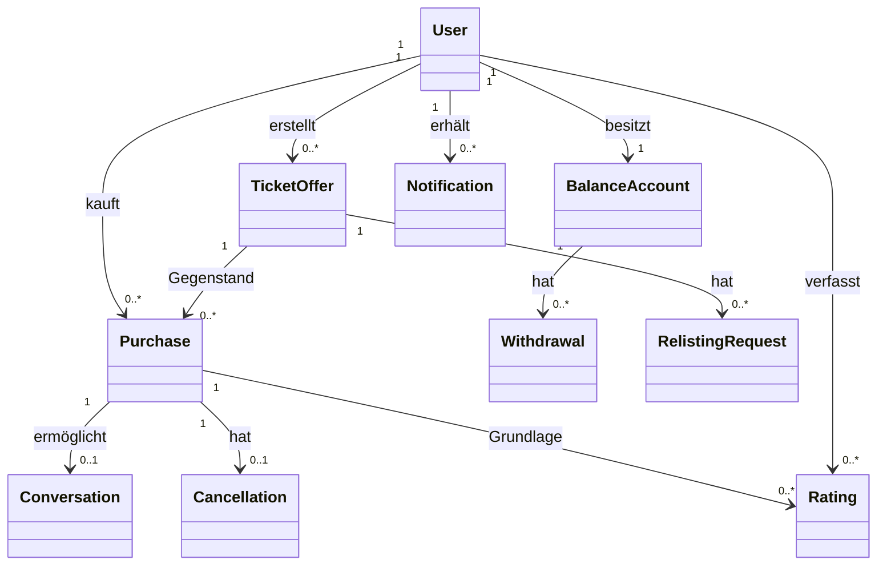
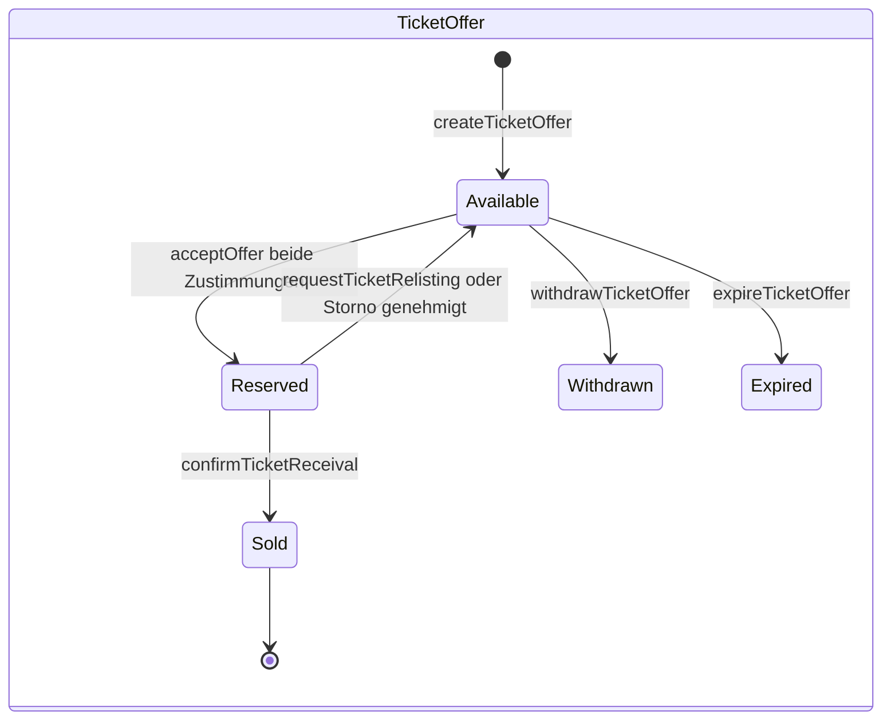
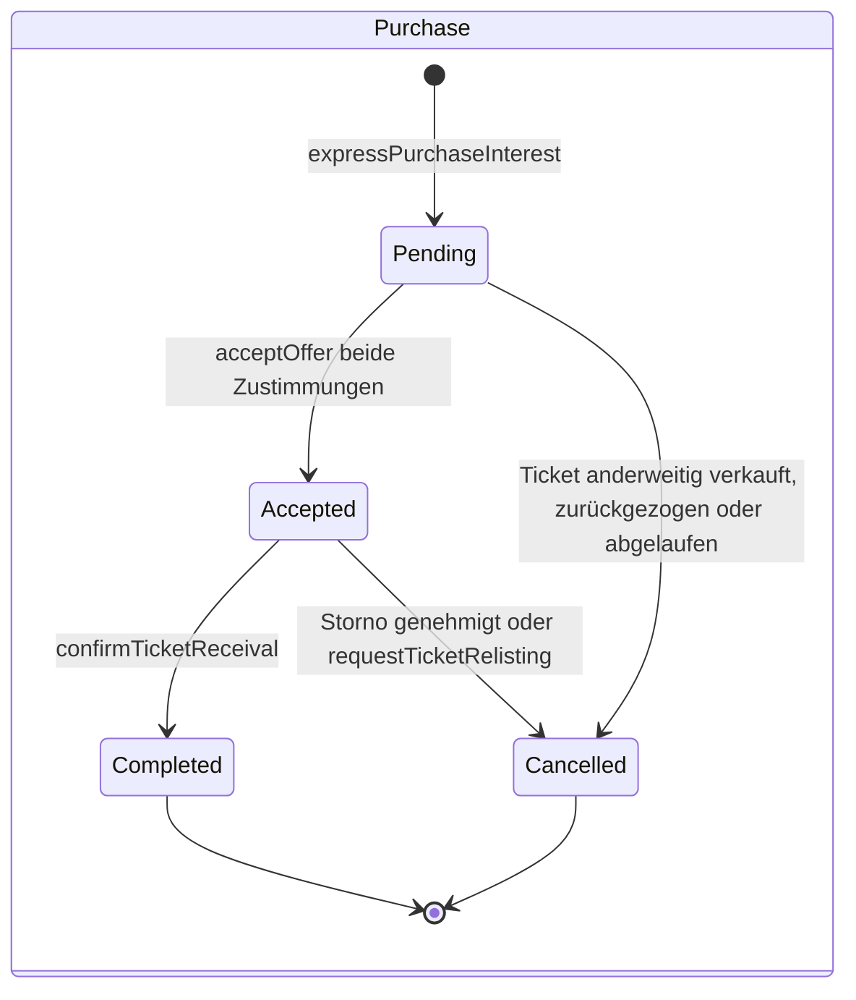
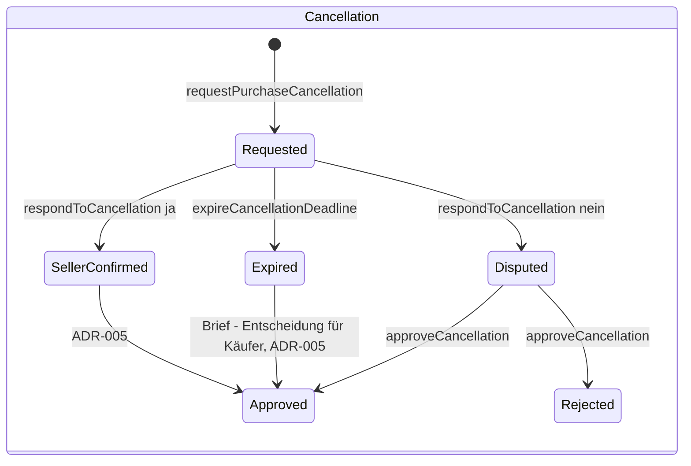
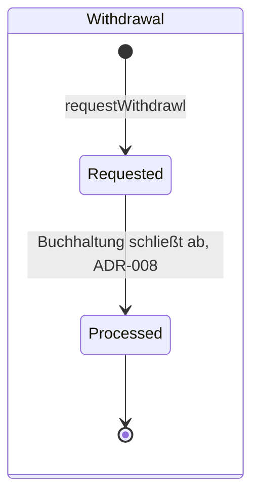
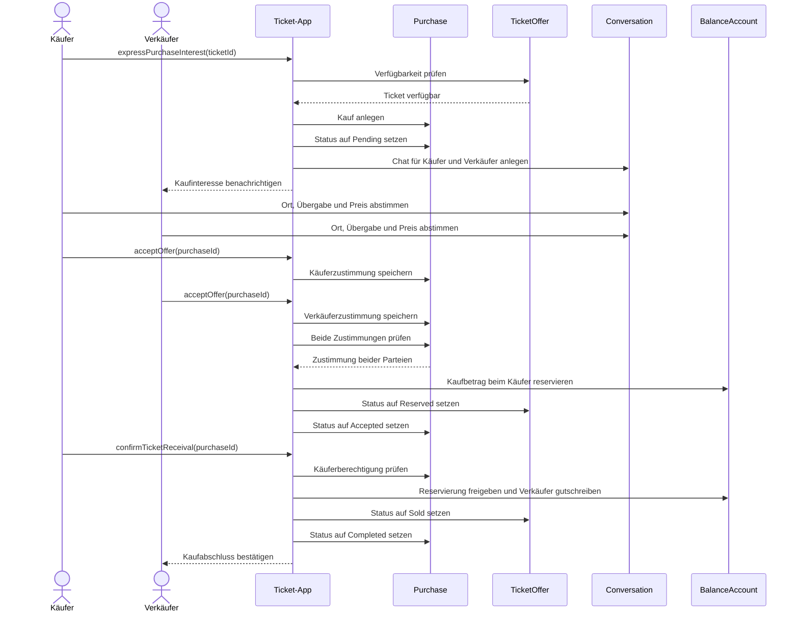
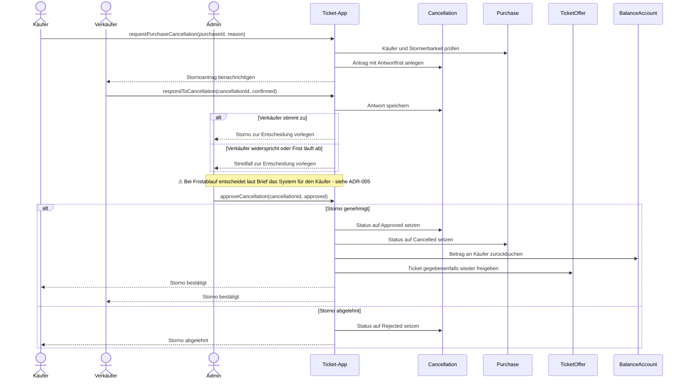
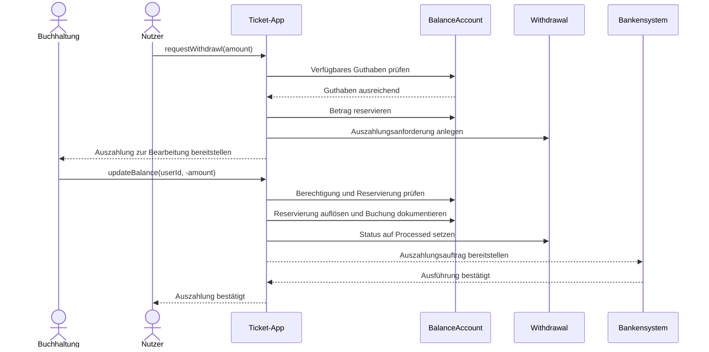
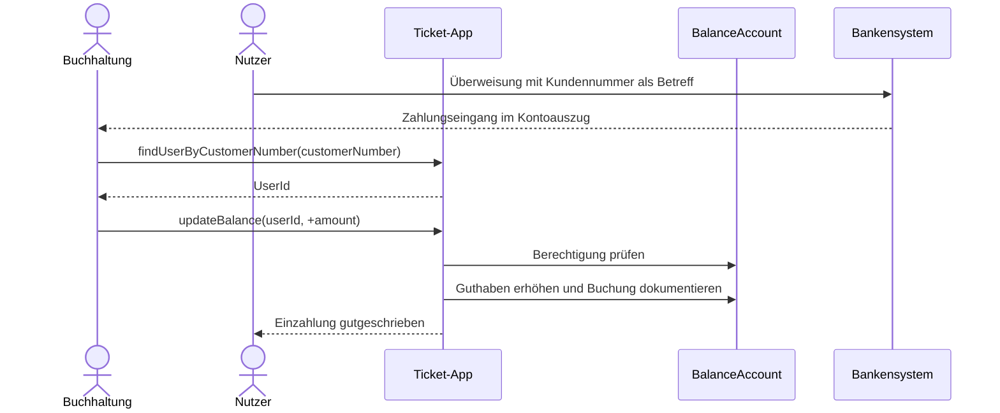

# Systemoperationen

Diese Spezifikation beschreibt die Systemoperationen nach dem Assemblage-Ansatz. Jede Operation enthält Signatur, fachliches Verhalten und nichtfunktionale Anforderungen. Die angegebenen Antwortzeiten sind Architekturvorschläge und keine gemessenen Grenzwerte. Jede Operation ist mit ihren Haupttreibern markiert: V = Verfügbarkeit, U = Usability, S = Security, R = Robustheit. Ergänzungen, die nicht aus dem Projektbrief stammen, sind mit `⚠ Annahme:` gekennzeichnet und unter „Offene Architekturentscheidungen" gelistet.

## Domänenmodell – Aggregates

| Aggregate | Beschreibung | Wichtige Daten |
| --- | --- | --- |
| `User` | Benutzerkonto und Benutzerstatus | UserId, Benutzername, Vorname, Nachname, Geburtsdatum, E-Mail, Kundennummer (Betreff für Einzahlungen), IBAN, Credentials, Rolle (User / Admin / Accounting), Status |
| `TicketOffer` | Zum Verkauf angebotenes Ticket | TicketId, SellerId, Start, End, ValidFrom, ValidUntil, Provider, Price, OriginalPrice, Status |
| `Purchase` | Kaufvorgang zwischen Käufer und Verkäufer | PurchaseId, TicketId, BuyerId, SellerId, AgreedPrice, BuyerAccepted, SellerAccepted, Status |
| `Conversation` | Kommunikation zwischen Käufer und Verkäufer | ConversationId, Participants, Messages |
| `BalanceAccount` | Guthabenkonto eines Benutzers | UserId, AvailableBalance, ReservedBalance, Transactions |
| `Withdrawal` | Auszahlungsanforderung | WithdrawalId, UserId, Amount, Status |
| `Cancellation` | Stornoantrag eines Käufers | CancellationId, PurchaseId, Reason, SellerResponse, Status, Deadline |
| `RelistingRequest` | Antrag zum erneuten Anbieten eines Tickets | RequestId, TicketId, Reason, Status |
| `Rating` | Bewertung eines Benutzers | RatingId, ReviewerId, RatedUserId, PurchaseId, Score, Comment |
| `Notification` | Benachrichtigung an einen Benutzer (→ ADR-010) | NotificationId, RecipientId, Anlass (Event), Inhalt, Status |

Aggregates sind fachliche Konsistenzgrenzen; daraus folgt nicht zwangsläufig eine Aufteilung in eigene Microservices.

**Benachrichtigungen (→ ADR-010):** „Benachrichtigt" bedeutet in allen Operationen: Die Operation publiziert ein fachliches Event (z. B. Kaufinteresse bekundet, Stornoantrag gestellt). Die Subdomäne Notification reagiert asynchron darauf und stellt die Nachricht zu. Die auslösende Operation wartet nicht auf die Zustellung.

### Beziehungen der Aggregates

### Statusmodelle

⚠ Annahme: Die Statuswerte `Sold`, `Withdrawn`, `Expired`, `SellerConfirmed`, `Disputed` und `Requested` sind ergänzt; der Brief definiert keine Lebenszyklen. Übergänge, die von offenen ADRs abhängen, sind markiert.

## User – Registrierung und Authentifizierung

### `register()`

**Signatur:** `register(userData: UserRegistrationData): UserId`

**Treiber:** U · S

**Verhalten**

- Liest: `User` zur Prüfung eindeutiger Benutzername- und E-Mail-Werte.
- Schreibt: `User` und initialisiert ein `BalanceAccount`.
- Erstellt ein Benutzerkonto mit den angegebenen persönlichen Daten (Vorname, Nachname, Geburtsdatum, Benutzername, E-Mail, IBAN), vergibt eine eindeutige Kundennummer und die Rolle `User`.
- Speichert das Passwort ausschließlich gehasht.

**Nichtfunktionale Anforderungen**

- Antwortzeit unter 2 Sekunden.
- Benutzername und E-Mail sind eindeutig.
- Personenbezogene Daten und Passwörter werden sicher verarbeitet.

### `login()`

**Signatur:** `login(username: String, password: String): AuthenticationResult`

**Treiber:** S · V

**Verhalten**

- Liest: `User`.
- Schreibt: keine fachlichen Aggregates. Der Brute-Force-Schutz (Zählen und Drosseln von Fehlversuchen) liegt im API Gateway (→ ADR-011).
- Prüft Anmeldedaten und Benutzerstatus; bei Erfolg wird eine Sitzung beziehungsweise ein Token zurückgegeben.
- Gesperrte Benutzer dürfen sich nicht anmelden.

**Nichtfunktionale Anforderungen**

- Antwortzeit unter 1 Sekunde.
- Schutz vor Brute-Force-Angriffen sowie sichere Übertragung und Verarbeitung der Anmeldedaten.

## User – Ticketsuche und Angebotserstellung

### `searchTicket()`

**Signatur:** `searchTicket(start: String, end: String, travelDate: Date, provider: String): List<TicketOffer>`

**Treiber:** V · U

**Verhalten**

- Liest: `TicketOffer`.
- Schreibt: keine.
- Sucht verfügbare Ticketangebote nach den angegebenen Filtern, berücksichtigt Gültigkeit und Verfügbarkeit und gibt passende Angebote zurück.

**Nichtfunktionale Anforderungen**

- Antwortzeit unter 1 Sekunde für typische Suchanfragen.
- Hohe Verfügbarkeit und effiziente Suche auch bei vielen Angeboten.

### `createTicketOffer()`

**Signatur:** `createTicketOffer(start: String, end: String, description: String, validFrom: DateTime, validUntil: DateTime, provider: String, price: Decimal, originalPrice: Decimal): TicketId`

**Treiber:** U · V

**Verhalten**

- Liest: `User`.
- Schreibt: `TicketOffer`.
- Prüft die Berechtigung zum Erstellen eines Angebots und validiert Ticketdaten, Preise und Gültigkeitszeitraum.
- Erstellt ein Angebot im Status `Available`, das anschließend in der Suche sichtbar ist.

**Nichtfunktionale Anforderungen**

- Antwortzeit unter 2 Sekunden.
- Dauerhafte Speicherung und idempotente Behandlung wiederholter identischer Anfragen.

## User – Kauf und Kommunikation

### `expressPurchaseInterest()`

**Signatur:** `expressPurchaseInterest(ticketId: TicketId): PurchaseId`

**Treiber:** V · U

**Verhalten**

- Liest: `TicketOffer`, `User`.
- Schreibt: `Purchase`, gegebenenfalls `Conversation`.
- Prüft die Verfügbarkeit des Tickets, erstellt einen Kaufvorgang im Status `Pending`, benachrichtigt den Verkäufer und ermöglicht die Kommunikation beider Parteien.

**Nichtfunktionale Anforderungen**

- Antwortzeit unter 2 Sekunden.
- Zuverlässige Benachrichtigung des Verkäufers.
- Für bereits verkaufte Tickets darf kein neuer Kaufabschluss erfolgen.

### `sendMessage()`

**Signatur:** `sendMessage(conversationId: ConversationId, content: String): MessageId`

**Treiber:** U · V

**Verhalten**

- Liest: `Conversation`, `User`.
- Schreibt: `Conversation`.
- Prüft die Teilnahme an der Konversation, speichert die Nachricht und stellt sie dem Empfänger bereit.

**Nichtfunktionale Anforderungen**

- Antwortzeit unter 1 Sekunde und möglichst geringe Zustellverzögerung.
- Nachrichten sind nur für berechtigte Teilnehmer sichtbar und zuverlässig gespeichert.

### `acceptOffer()`

**Signatur:** `acceptOffer(purchaseId: PurchaseId): PurchaseStatus`

**Treiber:** R · S

**Verhalten**

- Liest: `Purchase`, `TicketOffer`, `BalanceAccount`.
- Schreibt: `Purchase`, `TicketOffer`, `BalanceAccount`.
- Speichert die Zustimmung der aufrufenden Kaufpartei.
- ⚠ Annahme: Der im Chat vereinbarte Preis wird als `AgreedPrice` im `Purchase` festgehalten; beide Zustimmungen beziehen sich auf denselben Preis. Wie der Preis übergeben wird, ist offen.
- ⚠ Annahme: Das Verhalten bei unzureichendem Guthaben des Käufers ist offen.
- Sobald Käufer und Verkäufer zugestimmt haben, wird der Kaufbetrag (`AgreedPrice`) beim Käufer belastet oder reserviert, das Ticket als `Reserved` markiert und der Kaufstatus aktualisiert.

**Nichtfunktionale Anforderungen**

- Antwortzeit unter 2 Sekunden.
- Konsistente Geld- und Ticketzustände; keine Mehrfachabbuchungen.
- Parallele Kaufabschlüsse werden sicher behandelt.

### `confirmTicketReceival()`

**Signatur:** `confirmTicketReceival(purchaseId: PurchaseId): PurchaseStatus`

**Treiber:** R · S

**Verhalten**

- Liest: `Purchase`, `BalanceAccount`.
- Schreibt: `Purchase`, `BalanceAccount`, `TicketOffer`.
- Prüft, dass der Aufrufer Käufer ist, bestätigt den Erhalt, gibt den reservierten Betrag für den Verkäufer frei und markiert den Vorgang als `Completed`.
- ⚠ Annahme: Setzt das Ticket auf `Sold`, damit es nicht erneut angeboten werden kann.

**Nichtfunktionale Anforderungen**

- Antwortzeit unter 2 Sekunden.
- Geldtransfer erfolgt genau einmal und ist vollständig nachvollziehbar.

## User – Stornierung und erneutes Anbieten

### `requestPurchaseCancellation()`

**Signatur:** `requestPurchaseCancellation(purchaseId: PurchaseId, reason: String): CancellationId`

**Treiber:** U · R

**Verhalten**

- Liest: `Purchase`, `User`.
- Schreibt: `Cancellation`.
- Prüft die Berechtigung des Käufers, erstellt einen Stornoantrag mit Antwortfrist und benachrichtigt den Verkäufer.

**Nichtfunktionale Anforderungen**

- Antwortzeit unter 2 Sekunden sowie zuverlässige Benachrichtigung.
- Ein Kauf wird nicht mehrfach gleichzeitig storniert; die Frist wird zuverlässig überwacht.

### `respondToCancellation()`

**Signatur:** `respondToCancellation(cancellationId: CancellationId, confirmed: Boolean): CancellationStatus`

**Treiber:** U · R

**Verhalten**

- Liest: `Cancellation`, `Purchase`.
- Schreibt: `Cancellation`.
- Prüft die Identität des betroffenen Verkäufers und speichert Zustimmung oder Widerspruch.
- Bei Zustimmung kann der Storno genehmigt werden; bei Widerspruch kann der Fall an einen Administrator übergeben werden.

**Nichtfunktionale Anforderungen**

- Antwortzeit unter 2 Sekunden.
- Nur der betroffene Verkäufer darf antworten.
- Antworten nach Fristablauf sind definiert zu behandeln; Änderungen sind nachvollziehbar.

### `requestTicketRelisting()`

**Signatur:** `requestTicketRelisting(ticketId: TicketId): RelistingRequestId`

**Treiber:** R · S

**Verhalten**

- Liest: `TicketOffer`, `Purchase`.
- Schreibt: `RelistingRequest`, `TicketOffer`, `Purchase`, `BalanceAccount`.
- Prüft Verkäuferrolle und Voraussetzungen zum erneuten Anbieten.
- Erstellt den Antrag, setzt das Ticket wieder auf `Available` und veranlasst die Rückbuchung des Kaufbetrags an den Käufer.

**Nichtfunktionale Anforderungen**

- Antwortzeit unter 2 Sekunden.
- Kauf-, Ticket- und Guthabenstatus werden konsistent aktualisiert.
- Rückbuchungen erfolgen höchstens einmal.

## User – Bewertungen und Guthaben

### `rateUser()`

**Signatur:** `rateUser(purchaseId: PurchaseId, ratedUserId: UserId, score: Integer, comment: String): RatingId`

**Treiber:** R · S

**Verhalten**

- Liest: `Purchase`, `User`, `Rating`.
- Schreibt: `Rating`.
- Prüft die gemeinsame Beteiligung am Kaufvorgang, speichert die Bewertung und macht sie öffentlich sichtbar.

**Nichtfunktionale Anforderungen**

- Antwortzeit unter 2 Sekunden.
- Schutz vor unberechtigten und mehrfachen Bewertungen sowie nachvollziehbare Speicherung.

### `viewUserRatings()`

**Signatur:** `viewUserRatings(userId: UserId): List<Rating>`

**Treiber:** U · V

**Verhalten**

- Liest: `Rating`.
- Schreibt: keine.
- Ruft die öffentlichen Bewertungen eines Benutzers ab.

**Nichtfunktionale Anforderungen**

- Antwortzeit unter 1 Sekunde, hohe Verfügbarkeit und effiziente Abfrage bei vielen Bewertungen.

### `viewBalance()`

**Signatur:** `viewBalance(): BalanceInformation`

**Treiber:** U · S

**Verhalten**

- Liest: `BalanceAccount`.
- Schreibt: keine.
- Gibt verfügbares und gegebenenfalls reserviertes Guthaben des angemeldeten Benutzers zurück.

**Nichtfunktionale Anforderungen**

- Antwortzeit unter 1 Sekunde.
- Ausschließlich der Kontoinhaber darf das Guthaben einsehen; der Kontostand ist korrekt und aktuell.

### `requestWithdrawl()`

**Signatur:** `requestWithdrawl(amount: Decimal): WithdrawalId`

**Treiber:** S · R

**Verhalten**

- Liest: `User`, `BalanceAccount`.
- Schreibt: `Withdrawal`, gegebenenfalls `BalanceAccount`.
- Prüft das verfügbare Guthaben, erstellt eine Auszahlungsanforderung für Accounting und sichert den Betrag, etwa durch eine Reservierung.

**Nichtfunktionale Anforderungen**

- Antwortzeit unter 2 Sekunden.
- Keine Auszahlung über das verfügbare Guthaben; zuverlässige und nachvollziehbare Verarbeitung.

## Admin – Verwaltung und Stornierungen

### `blockUser()`

**Signatur:** `blockUser(userId: UserId): UserStatus`

**Treiber:** S

**Verhalten**

- Liest: `User`, gegebenenfalls `Cancellation`.
- Schreibt: `User`.
- Prüft die Administratorberechtigung, sperrt den Benutzer und verhindert künftige unberechtigte Aktionen.

**Nichtfunktionale Anforderungen**

- Antwortzeit unter 2 Sekunden.
- Ausschließlich autorisierte Administratoren dürfen sperren; Sperrungen werden nachvollziehbar protokolliert.

### `requestTicketReceivalStatus()`

**Signatur:** `requestTicketReceivalStatus(purchaseId: PurchaseId): RequestId`

**Treiber:** R · U

**Verhalten**

- Liest: `Purchase`, `User`.
- Schreibt: gegebenenfalls `Conversation` oder einen Supportvorgang.
- Prüft, dass der Kauf noch nicht abgeschlossen ist, und fordert beim Verkäufer eine Auskunft zur Ticketübergabe an.

**Nichtfunktionale Anforderungen**

- Antwortzeit unter 2 Sekunden für die Anfrage.
- Zuverlässige Zustellung und nachvollziehbare Kommunikation.

### `approveCancellation()`

**Signatur:** `approveCancellation(cancellationId: CancellationId, approved: Boolean): CancellationStatus`

**Treiber:** R · S

**Verhalten**

- Liest: `Cancellation`, `Purchase`, `TicketOffer`, `BalanceAccount`.
- Schreibt: `Cancellation`, `Purchase`, `BalanceAccount`, gegebenenfalls `TicketOffer`.
- Prüft die Administratorberechtigung und genehmigt oder lehnt den Antrag ab.
- Bei Genehmigung werden Kauf und Stornierungsstatus aktualisiert, der Betrag an den Käufer zurückgebucht und alle Beteiligten informiert.

**Nichtfunktionale Anforderungen**

- Antwortzeit unter 2 Sekunden.
- Konsistente, genau einmal ausgeführte Rückbuchung sowie nachvollziehbare Entscheidungen und Geldbewegungen.

## Accounting – Guthabenverwaltung

### `updateBalance()`

**Signatur:** `updateBalance(userId: UserId, amount: Decimal): BalanceInformation`

**Treiber:** S · R

**Verhalten**

- Liest: `User`, `BalanceAccount`.
- Schreibt: `BalanceAccount`.
- Prüft die Berechtigung der Buchhaltung, aktualisiert das Guthaben und dokumentiert die Änderung als Transaktion.
- Positive Beträge erhöhen, negative Beträge verringern das Guthaben. Die Operation unterstützt die manuelle Bearbeitung von Ein- und Auszahlungen.

**Nichtfunktionale Anforderungen**

- Antwortzeit unter 2 Sekunden.
- Hohe Datenkonsistenz und Transaktionssicherheit, keine unzulässigen negativen Guthabenstände.
- Vollständige Protokollierung; Zugriff ausschließlich für autorisierte Buchhaltungsmitarbeiter.

## User – Angebotsverwaltung (ergänzt)

### `withdrawTicketOffer()`

**Signatur:** `withdrawTicketOffer(ticketId: TicketId): TicketStatus`

**Treiber:** U

**Verhalten**

- Liest: `TicketOffer`, `Purchase`.
- Schreibt: `TicketOffer`, `Purchase`.
- Prüft, dass der Aufrufer Verkäufer ist, setzt das Ticket auf `Withdrawn`, beendet offene `Pending`-Käufe als `Cancelled` und benachrichtigt die Interessenten.
- ⚠ Annahme: Nur im Status `Available` zulässig; ein reserviertes Ticket wird über `requestTicketRelisting()` behandelt.

**Nichtfunktionale Anforderungen**

- Antwortzeit unter 2 Sekunden.
- Zurückgezogene Angebote sind sofort nicht mehr in der Suche sichtbar.

### `updateTicketOffer()`

**Signatur:** `updateTicketOffer(ticketId: TicketId, changes: TicketOfferChanges): TicketId`

**Treiber:** U

**Verhalten**

- Liest: `TicketOffer`.
- Schreibt: `TicketOffer`.
- Prüft Verkäuferrolle und validiert die geänderten Daten wie bei `createTicketOffer()`.
- ⚠ Annahme: Nur im Status `Available` zulässig.

**Nichtfunktionale Anforderungen**

- Antwortzeit unter 2 Sekunden.

## System – Zeitgesteuerte Operationen (ergänzt)

### `expireCancellationDeadline()`

**Signatur:** `expireCancellationDeadline(cancellationId: CancellationId): CancellationStatus` – ausgelöst bei Erreichen von `Cancellation.Deadline`.

**Treiber:** R · U

**Verhalten**

- Liest: `Cancellation`, `Purchase`.
- Schreibt: `Cancellation`; bei automatischer Stornierung zusätzlich `Purchase`, `BalanceAccount`, `TicketOffer`.
- Wirkt nur, wenn der Verkäufer bis zur Frist nicht geantwortet hat; setzt den Antrag auf `Expired`.
- Laut Brief wird in diesem Fall für den Käufer entschieden. Ob das direkt zur Stornierung mit Rückbuchung führt oder den Fall dem Admin vorlegt, entscheidet ADR-005.

**Nichtfunktionale Anforderungen**

- Die Frist wird zuverlässig überwacht, auch nach Ausfällen (keine verpasste Frist).
- Idempotent: eine verspätete Verkäuferantwort und der Fristablauf führen nicht zu doppelter Rückbuchung.

### `expireTicketOffer()`

**Signatur:** `expireTicketOffer(ticketId: TicketId): TicketStatus` – ausgelöst bei Erreichen von `TicketOffer.ValidUntil`.

**Treiber:** R · U

**Verhalten**

- Liest: `TicketOffer`, `Purchase`.
- Schreibt: `TicketOffer`, `Purchase`.
- Ein Ticket im Status `Available` wird auf `Expired` gesetzt und aus der Suche entfernt; offene `Pending`-Käufe werden `Cancelled`.
- ⚠ Annahme: Das Verhalten für ein Ticket im Status `Reserved` (Kauf `Accepted`, Erhalt noch nicht bestätigt) ist offen.

**Nichtfunktionale Anforderungen**

- Abgelaufene Tickets erscheinen nicht mehr in `searchTicket()`.

## Ergänzte Abfragen

Reine Leseoperationen; sie schreiben keine Aggregates. Antwortzeiten sind Architekturvorschläge.

| Operation | Signatur | Actor | Liest | Treiber | NFR |
| --- | --- | --- | --- | --- | --- |
| `viewOwnTicketOffers()` | `viewOwnTicketOffers(): List<TicketOffer>` | User (Verkäufer) | `TicketOffer` | U | < 1 s; nur eigene Angebote |
| `viewOwnPurchases()` | `viewOwnPurchases(): List<Purchase>` | User (Käufer/Verkäufer) | `Purchase`, `TicketOffer` | U | < 1 s; nur eigene Käufe |
| `viewConversation()` | `viewConversation(conversationId: ConversationId): List<Message>` | User | `Conversation` | U | < 1 s; nur Teilnehmer |
| `viewBalanceTransactions()` | `viewBalanceTransactions(): List<Transaction>` | User | `BalanceAccount` | U · S | < 1 s; nur Kontoinhaber |
| `viewOpenCancellations()` | `viewOpenCancellations(): List<Cancellation>` | Admin | `Cancellation`, `Purchase` | U · S | < 2 s; nur Admin |
| `viewPendingWithdrawals()` | `viewPendingWithdrawals(): List<Withdrawal>` | Accounting | `Withdrawal`, `User` (IBAN) | U · S | < 2 s; nur Accounting |
| `findUserByCustomerNumber()` | `findUserByCustomerNumber(customerNumber: String): UserInfo` | Accounting | `User` | U · S | < 1 s; nur Accounting; ordnet Einzahlungen über den Betreff zu |

## Sequenzdiagramme

Die folgenden Diagramme konkretisieren die fachlich komplexeren Abläufe. Das Bankensystem ist nur ein externer Beteiligter; eine direkte technische Integration ist nicht Teil der Spezifikation.

### Kaufabschluss

### Stornierungsprozess

### Manuelle Guthabenverwaltung

### Einzahlung

## Offene Architekturentscheidungen

| Thema | Offene Frage |
| --- | --- |
| Kaufinteresse | Können mehrere Käufer gleichzeitig Interesse an einem Ticket bekunden? |
| Kaufabschluss | Wie wird verhindert, dass zwei Käufer dasselbe Ticket kaufen? |
| Storno | Wird nach einer Bestätigung durch den Verkäufer automatisch storniert oder entscheidet immer ein Admin? |
| Ticket-Relisting | Darf der Verkäufer das Ticket sofort erneut anbieten oder nur unter bestimmten Bedingungen? |
| Guthaben | Wird Geld beim Kauf sofort abgebucht oder zunächst reserviert? |
| Accounting | Wie wird eine manuelle Auszahlung als abgeschlossen dokumentiert, ohne das Guthaben doppelt zu belasten? |
| Bewertungen | Darf jeder Benutzer bewerten oder nur nach einem abgeschlossenen Kauf? |
| Preis | Wie wird der im Chat vereinbarte Preis verbindlich als `AgreedPrice` im `Purchase` festgehalten (Parameter von `acceptOffer()` oder eigene Operation)? |
| Kaufabschluss | Was passiert bei `acceptOffer()`, wenn das Guthaben des Käufers nicht ausreicht (Ablehnung, Zustimmung bleibt offen bis Einzahlung, …)? |
| Ticket-Gültigkeit | Was passiert mit einem Kauf im Status `Accepted`, wenn `ValidUntil` des Tickets abläuft (`expireTicketOffer()`)? |
| Angebotsverwaltung | Darf ein Angebot mit offenen `Pending`-Käufen bearbeitet oder zurückgezogen werden? |
| Statusmodelle | Sind die ergänzten Statuswerte (`Sold`, `Withdrawn`, `Expired`, `SellerConfirmed`, `Disputed`, `Requested`) und Übergänge korrekt? |
| Benachrichtigungen | → ADR-010 |
| Login | → ADR-011 |

Besonders für Auszahlungen muss das Auflösen einer zuvor angelegten Reservierung definiert werden. Andernfalls besteht das Risiko, dass bei einer späteren negativen `updateBalance()`-Buchung derselbe Betrag doppelt abgezogen wird.
